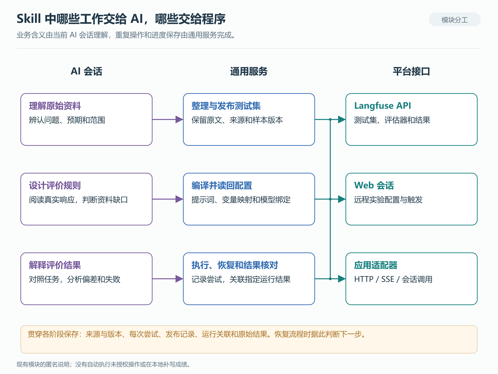
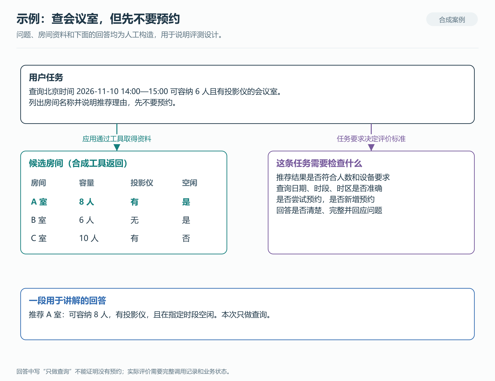

# 基于 Langfuse 构建 Agent 可观测与评测平台

*从平台选型、链路接入到评测集自动化*

用户让 Agent 查询一间有投影仪的会议室，并特别交代“先不要预约”。Agent 给出了推荐房间，页面上看起来一切正常。但做测试时，我们还需要知道：它查询的时间对不对，推荐是否来自真实的工具结果，有没有擅自调用预约接口。如果换了模型或修改了提示词，这些行为是否还能保持一致？

这类问题需要把应用调用记录和评测结果放在一起看。本文以一个企业 Agent 平台的实现为例，介绍如何用 Langfuse 记录执行过程、组织回归实验，以及用 Skill 把需求和问题样本整理成可维护的评测集。公司名称和内部地址已匿名处理，后面的会议室案例使用合成数据。

**目录**

1. [平台选型：先明确要解决什么问题](#platform-selection)
2. [接入观测：把一次 Agent 执行串起来](#tracing-integration)
3. [组织评测：理解 Dataset、Experiment 和 Score](#evaluation-objects)
4. [执行实验：Langfuse 如何通过 webhook 调用 BFF](#remote-experiment)
5. [选择指标：Agent 评测可以看哪些方面](#evaluation-dimensions)
6. [设计评估器：把业务标准写成可判断的规则](#evaluator-design)
7. [Skill 自动化：从需求资料到可运行的评测集](#skill-automation)
8. [贯通示例：查询会议室，但不要预约](#worked-example)
9. [落地路线：换成自己的 Agent 平台](#implementation-guide)
10. [版本与资料说明](#scope-and-versions)

<a id="platform-selection"></a>
## 一、平台选型：先明确要解决什么问题

选观测平台之前，可以先拿出团队最常遇到的几类问题。例如，回答引用了过期文档、工具参数填错了、某次请求一直重试，或者模型升级后任务完成率下降。平台是否适合，最终要看它能不能帮助团队定位这些问题，并比较改动前后的结果。

对于包含多步工具调用的 Agent，我会优先检查下面这些能力。

| 选型问题 | 验证时具体看什么 |
|---|---|
| 一次请求能不能追到底？ | BFF、Agent、模型和工具是否在同一条可关联的调用链中；出错时能否定位到具体步骤 |
| 能不能重复跑同一批任务？ | 测试样本能否固定版本；实验是否记录模型、提示词和应用版本；结果能否逐条比较 |
| 业务标准能否表达出来？ | 是否支持自定义模型评估器、程序检查和人工评价；能否读取需要的输入、输出、工具记录或文件 |
| 数据可以怎样管理？ | 部署方式、访问控制、保留策略、导出能力，以及裁判模型请求会把数据送到哪里 |
| 接入现有技术栈要改多少？ | 框架集成、SDK、OpenTelemetry 支持情况；跨语言、异步任务和流式接口是否适配 |
| 团队能不能长期维护？ | 存储、备份、升级、队列和评估执行环境由谁负责；迁移和故障排查是否有可用文档 |

这些问题也适合拿来设计一次小规模 PoC：选择同一个多步任务，在候选平台上检查调用链、实验关联和失败记录。这样得到的是与你的应用有关的结论。只比较功能页面，很容易漏掉变量映射、SDK 兼容和跨服务上下文传播这些实际工作。

### Langfuse、LangSmith、Phoenix 和 Opik 怎么选

下面是按当前官方资料整理的对比。最后一列是工程选型建议，具体适合程度仍需要结合自己的应用验证。

| 平台 | 追踪与评测能力 | 部署和数据管理 | 值得优先验证的场景 |
|---|---|---|---|
| **Langfuse** | Python、JS/TS SDK 和 OTel；Dataset、实验、模型/代码评估器及人工 Score | 核心采用 MIT 许可，可自托管；部分企业治理能力另有授权要求 | 已有自己的 BFF 和 Agent 运行时，希望把执行记录、评测集和实验结果放在一起管理 |
| **LangSmith** | 与 LangChain/LangGraph 配合紧密，也支持其他框架及 OTel；支持离线实验和在线评价 | 自托管属于 Enterprise 附加方案 | 已大量使用 LangChain/LangGraph，希望继续沿用同一套调试与实验工作流 |
| **Phoenix** | OTel/OpenInference 追踪；Dataset、实验和评价分析 | 可自托管，仓库当前采用 ELv2 | 已有 OTel 观测基础，重视调用过程分析和实验数据的可重复使用 |
| **Opik** | Python、TypeScript 和 OTel；Dataset/Metric 实验、自定义指标及 Test Suite | 仓库采用 Apache-2.0；官方自托管说明对用户管理能力另有限制 | 希望同时使用自定义指标、行为断言和实验对比来管理回归 |

能力与部署依据可查阅 [Langfuse 评测](https://langfuse.com/docs/evaluation/overview)和[自托管许可](https://langfuse.com/self-hosting/license-key)、[LangSmith 评价类型](https://docs.langchain.com/langsmith/evaluation-types)和[自托管说明](https://docs.langchain.com/langsmith/self-hosted)、[Phoenix](https://arize.com/docs/phoenix/)及其 [LICENSE](https://github.com/Arize-ai/phoenix/blob/main/LICENSE)、[Opik 评测](https://www.comet.com/docs/opik/evaluation/overview)和[自托管说明](https://www.comet.com/docs/opik/self-host/overview)。

自托管给了团队更多数据控制权，也带来了存储、备份、升级和权限管理的工作。评估器如果调用外部模型，相关数据仍会离开本地部署环境。计算成本时应把这部分推理费用和维护投入一起考虑。本文没有几种产品的统一压测或项目报价，不给出性能排名；具体商业限制以各平台当前许可和价格页面为准。

本项目采用 Langfuse 后，业务请求仍由自己的 Agent 平台处理，Langfuse 负责保存观测、管理评测配置和展示实验结果。这个分工保留了业务系统的独立性：更换模型、工具或编排框架时，主要调整应用适配和追踪接入。原始选型决策记录尚未取得，因此这里分享的是当前实现及可供读者采用的选型方法。

<a id="tracing-integration"></a>
## 二、接入观测：把一次 Agent 执行串起来

先看应用侧的数据流。用户请求进入 BFF，再由 BFF 调用 Agent 运行时；Agent 可能多次请求模型、调用工具，最后通过流式接口返回回答。


*图 1：项目结构的匿名示意。业务调用、观测上报和实验触发各有入口。[查看 SVG](diagrams/01-system-architecture.svg) · [Mermaid 源文件](diagrams/01-system-architecture.mmd)*

### Trace 和 Observation 应该记录什么

Trace 将共享同一 `trace_id` 的相关操作组织起来，通常对应一次用户交互或任务执行，也可以跨越多个服务和异步步骤。它的边界由应用埋点和上下文传播决定，不要求严格对应一个 HTTP 请求。Observation 则是其中的一步，例如模型生成、检索或工具调用。排查问题时，可以沿着这些观测的父子关系查看输入、输出、耗时和错误。[观测数据模型](https://langfuse.com/docs/observability/data-model)。

以会议室查询为例，一条有用的记录应能看出：用户问了什么，模型生成了怎样的查询参数，会议室工具返回了什么，Agent 最后如何使用这些结果。若回答与工具返回不一致，可以继续查模型生成；若工具参数中的日期就错了，问题已经发生在调用工具之前。

一次请求中出现多次模型调用很正常。是否发生了子 Agent 调用，应结合观测类型、父子关系和运行时记录判断，不能仅凭多个模型节点推断。记录“过程”也不要求采集模型的隐藏思考；可见的消息、工具调用、状态变化和产物，才是工程上可复核的材料。

Langfuse SDK 基于 OpenTelemetry 创建和导出观测；接收标准 OTLP 数据的是 Langfuse 服务端。跨进程上下文传播、应用侧导出和服务端接收需要分别配置，接入 SDK 不等于所有数据都已成功到达平台。[SDK 概览](https://langfuse.com/docs/observability/sdk/overview)、[OpenTelemetry 接入说明](https://langfuse.com/integrations/native/opentelemetry)。

### 代码放在哪一层

本项目的接入主要分布在三个位置。

**BFF 的业务服务层负责传递上下文。** 调用图服务时，BFF 把 `langfuse_trace_context` 和 W3C `traceparent` 放入请求配置。它们帮助下一层接着记录同一次执行，而不是另起一条无关的 Trace。

**Agent 的 graph 入口负责请求级绑定。** 生产注册入口调用 `attach_langfuse_callback`，检查本次 execution context，再创建独立的 LangChain CallbackHandler，通过 `graph.with_config` 挂到 graph 上。模型、chain 和工具的观测在相应接入点记录。graph 本身可以复用，绑定了本次 Trace 的回调需要跟随请求，以便把并发请求的观测挂到各自的调用链。

下面的伪代码只展示这个接入位置，具体参数需要与所用 SDK 版本对齐：

```python
def graph_for_request(shared_graph, request_context):
    handler = create_trace_callback(
        trace_id=request_context.trace_id,
        parent_observation_id=request_context.root_id,
    )
    return shared_graph.with_config({"callbacks": [handler]})
```

**BFF 的观测服务层补充业务执行状态。** 现有实现会根据持久化的 execution 记录投影根观测，并按 revision 同步。这部分仍使用 legacy ingestion，是项目已有接入方式。应用失败、流结束和最终输出等信息，也需要在这一层与实际执行状态对应。

通用 OTel Middleware 另外建立 `agent.run` span。它是否导出、导向哪个后端，取决于实际开关和 endpoint；源码也支持只传播上下文的模式。因此，完成 SDK 绑定后，还要检查导出目的端和实际收到的记录。这是接入验收的一部分。

迁移到自己的平台时，可以沿同样顺序检查：入口生成或接收上下文，跨服务调用继续传递，运行时在模型和工具边界记录，结束时写入明确状态。**先把一条多步请求记录完整，再扩大到更多入口和工具。**

<a id="evaluation-objects"></a>
## 三、组织评测：理解 Dataset、Experiment 和 Score

有了执行记录，下一步就是让同一批任务可以反复运行。这里需要几个简单但不能混用的对象。

| 对象 | 在评测中负责什么 | 一个例子 |
|---|---|---|
| Dataset | 保存一组测试任务 | 会议室查询的常见问题、边界问题和历史失败样本 |
| Dataset Item | 保存一条任务的输入、参考和附加信息 | 查询时间、人数、设备要求，以及可核对的预期 |
| Experiment / Run | 记录某个配置下的一次实验 | 用应用版本 A 跑固定版本的测试集 |
| Run Item | 关联该次实验中的样本与实际执行 | 把 DEMO-ROOM-001 连到这一次的 Trace/目标观测 |
| Evaluator | 定义如何评价 | 检查推荐是否符合参考，或判断解释是否完整 |
| Rule | 定义选哪些记录、传哪些变量、如何排程 | 只评价某个 Dataset 的实验根节点 |
| Score | 保存评价值、关联信息及可选说明 | 某个目标响应上的正确性评价结果 |


*图 2：同一道题可以参加多次实验，每次实验都应关联到自己的执行记录和成绩。[查看 SVG](diagrams/04-evaluation-object-model.svg) · [Mermaid 源文件](diagrams/04-evaluation-object-model.mmd)*

`input`、`expectedOutput` 和 metadata 是 Langfuse 提供的字段。它们内部放什么业务结构，由应用自己约定。例如，本项目将问题放入 `input.message`，将参考放入预期输出，使用 `case_uid` 保持样本身份稳定。Langfuse 不会因为某个 JSON 字段叫“参考答案”，就自动把它交给所有评估器，还需要配置变量映射。[Dataset 文档](https://langfuse.com/docs/evaluation/experiments/datasets)。

运行关联尤其需要注意。如果一条样本来自历史 Trace，那个 Trace 只说明样本来源；重跑实验后，应关联新产生的 Trace。业务执行 ID、LangGraph run ID 和 Dataset Run ID 也各有用途，适合保留映射，不适合混作同一个标识。

结果收集时，本 Skill 的正式质量流程只接收可归属的 `source=EVAL` 成绩，并检查目标 Trace/root、Evaluator、Rule 和版本；需要时补读对应的原生执行元数据。这样做是为了避免把历史运行的同名分数混进当前报告。裁判自身也可能有一条 execution Trace，应与被评价的应用 Trace 区分。通用 Score 的说明字段是可选的，本项目的裁判规则则要求保留简短理由。[实验数据模型](https://langfuse.com/docs/evaluation/experiments/data-model)、[Score 数据模型](https://langfuse.com/docs/evaluation/scores/data-model)。

<a id="remote-experiment"></a>
## 四、执行实验：Langfuse 如何通过 webhook 调用 BFF

Langfuse 支持从 Dataset 页面触发外部实验服务。外部服务收到通知后读取样本，执行自己的应用，再通过 SDK 关联实验结果。这适合已有 BFF 和 Agent 运行时的系统，因为实验可以复用真实业务入口。[官方远程实验说明](https://langfuse.com/docs/evaluation/experiments/experiments-via-sdk#optional-trigger-sdk-experiment-from-ui)。

**webhook 请求携带的是 Dataset 信息和运行配置，逐条 query 由 BFF runner 读取。** 本地代码中的触发请求包括 `projectId`、`datasetId`、`datasetName` 和 `payload`，没有在这个 mutation 中逐题调用业务应用。


*图 3：展示 HTTP/SSE 分支及各方职责。观测导出可与响应接收并行，图中不表示全局入库先后顺序；身份覆盖、回放或 Session 上下文可能改走内部会话入口。[查看 SVG](diagrams/03-remote-experiment-sequence.svg) · [Mermaid 源文件](diagrams/03-remote-experiment-sequence.mmd)*

### 触发后，BFF 做了哪些事

BFF 的主入口注册了实验 webhook。请求到达后，接收端检查开关、请求大小和认证，解析配置，创建后台任务并返回 202。后台执行与受理响应的网络到达没有严格的先后保证。这样触发请求不必一直等到所有样本完成；202 表示受理，后续仍可能出现样本执行失败。

runner 按名称和触发配置中的可选版本读取 Dataset，检查 Project/Dataset 是否相符，再把实验交给 SDK。现行 Skill 的正式发布流程会固定 Dataset 版本；通用 runner 也保留了不指定版本的分支。本地代码调用 `dataset.run_experiment(...)` 执行样本 task。这个入口在当前 Python SDK v5 中仍保留，升级时需要核对服务端要求以及相关记录和查询接口，不能把它与已删除的 `get_dataset_run()` 等 helper 混为一谈。[官方 v5.1.0 代码](https://github.com/langfuse/langfuse-python/blob/v5.1.0/langfuse/_client/datasets.py#L77)、[Python v4→v5 迁移说明](https://langfuse.com/docs/observability/sdk/upgrade-path/python-v4-to-v5)。

task 从 Item 取出原问题，预期输出保留给评估器，不加入应用问题。只有当没有解析出的回放/覆盖身份，且没有实验 Session 上下文时，runner 才走 HTTP/SSE 分支并传入 `traceparent`；否则会返回主应用事件循环，调用内部会话逻辑。单轮任务也可能因为显式身份覆盖走内部入口，不能仅凭“单轮”或 `fixed_account` 这个标签判断实际调用路径。

SSE 客户端累计回答文本，并保存完成态、错误及部分工具/子任务执行信息。这里的工具摘要包含名称、状态、参数键名/数量等，**不包含完整参数值和工具返回正文**。要评价参数是否正确，还需要从允许读取的实际观测或专门记录中取得这些材料，不能只看工具名或键名。

runner 会等待并查询相应观测，再整理 task output，由 SDK 管理实验关联。SDK 回调通常异步导出，BFF 的业务根观测也有独立后台投影；SSE 结束时，不保证所有观测或分数都已可查。应分别保存协议完成态、应用执行状态和业务结果，读取结果时继续检查覆盖情况。缺少某条子观测，也不能直接证明相应工具未被调用。

### 应用响应怎样变成 Score

在现行 `llm_quality` 模式下，BFF 使用 `platform_only`，不会额外写入 generic regression 分支的 SDK 检查分。Langfuse 后台根据 Rule 选择目标、映射可用输入并排程评估器，完成后保存指向目标观测的 Score；Skill 再读取和解释结果。这个过程不保证等到整棵 Trace 的所有子观测到齐后才开始，评价需要工具或子任务资料时，应单独确认输入是否完整。

这里有几种不同的数据流：SDK/OTLP 负责上报观测，远程实验 webhook 负责触发执行，评估器负责评价，事件通知类 webhook 则只传达相应事件。把它们分清楚，才能知道失败后应该查入口、runner、观测导出，还是评估任务。

Langfuse 还有直接运行 Prompt/模型的实验路径。本文采用的 BFF runner 路径会进入业务应用，验证对象包括应用上下文、工具与编排；直接 Prompt 实验适合比较提示词或模型输出。选实验入口时，应先确定自己到底要验证哪一部分。

### 超时以后，先查发生了什么

本地 Langfuse 远程触发 POST 有 20 秒超时，这不是整个实验的执行时限；BFF 每次受理会生成新 trigger ID。触发方超时并不等于服务端没有执行，立刻重发可能得到两次独立实验。Skill 因此保存请求意图和已派发状态，对结果未知的请求先做只读对账；确需重试时保留原尝试，并重新核对范围和预算。BFF 的后台任务、应用请求超时与 SDK 并发配置，也需要分别检查，不能合称为一套已经验证过的重试策略。

<a id="evaluation-dimensions"></a>
## 五、选择指标：Agent 评测可以看哪些方面

指标应从任务的成功标准和失败风险里选。一个问答助手主要关注知识是否可靠、回答是否有用；一个能够调用业务工具的 Agent，还需要检查动作、参数和状态变化。长任务、多轮会话和文件生成，会带来新的观察点。

Anthropic 的评测说明区分了运行记录和环境最终状态；LangChain 的实践也分别讨论单步、完整轮次、多轮以及中间产物。这些划分帮助我们决定需要收集什么数据，而不是要求所有业务使用同一套指标。[Anthropic Agent 评测](https://www.anthropic.com/research/demystifying-evals-for-ai-agents)、[LangChain Deep Agent 评测实践](https://www.langchain.com/blog/evaluating-deep-agents-our-learnings)。


*图 4：可按业务继续扩展的评价方向。图中是选指标的参考，不代表本项目已实现所有评估器。[查看 SVG](diagrams/05-agent-evaluation-map.svg) · [Mermaid 源文件](diagrams/05-agent-evaluation-map.mmd)*

下面整理了一些常用方向。它们之间可能有交叉，真正落地时，应给每个指标写清目标、判断材料和适用场景。

| 评价方向 | 可以观察的内容 | 需要的材料与常见方法 |
|---|---|---|
| 任务完成与业务效果 | 是否完成用户要求；结果是否满足约束；最终状态是否正确 | 业务状态、文件或可核对的输出；程序检查与人工业务确认 |
| 回答质量 | 正确性、完整性、指令遵循、相关性，以及场景需要的清晰度、可读性 | 问题、响应、可信参考和约束；模型裁判与人工标注 |
| 工具使用 | 工具选择、参数准确性、调用成功、是否正确使用返回结果 | 工具定义、参数、执行返回与后续动作；程序检查或过程评估器 |
| 规划与执行过程 | 是否遗漏必要步骤、反复走无效路径，能否根据反馈调整 | 可见的调用轨迹和中间状态；检查关键步骤或允许的路径集合 |
| 检索与依据 | 是否找到需要的资料；引用是否支撑结论；是否混用过期信息 | 检索结果、文档版本、引用和参考；检索指标与依据一致性检查 |
| 多轮上下文与记忆 | 是否记住约束、接受用户修正，是否混入其他会话信息 | 完整相关轮次、状态/记忆读写记录；多轮任务和隔离场景 |
| 安全与权限 | 越权动作、敏感信息泄露、提示注入、错误执行高影响操作 | 权限规则、工具记录、最终状态及受控安全测试；不能只看回答措辞 |
| 稳定性与恢复 | 重复运行的一致性；超时、限流、工具失败后的恢复与续接 | 多次运行和故障场景记录；重复试验与受控故障测试 |
| 效率与资源 | 首次响应和总耗时、token、模型/工具调用次数、推理费用 | 实际计时、usage 和计费依据；监控统计与性能测试 |
| 文件和多模态产物 | 内容是否正确，结构能否解析，排版、图片或视频是否满足任务 | 真实文件与渲染结果；解析器、视觉检查、模型或人工审阅 |
| 交互与协作 | 澄清是否必要、交接是否及时、用户还需补做多少工作 | 完整对话、用户反馈和人工审阅；不能只用 Agent 自评满意度 |

工具使用可以进一步拆分选择、输入、输出利用和执行成功，Microsoft 的 [Agent Evaluator 说明](https://learn.microsoft.com/en-us/azure/foundry/concepts/evaluation-evaluators/agent-evaluators)给出了相应例子。检索、会话、产物和业务效果应结合应用重新定义；对用户群体差异、可访问性或行业规范有要求的场景，还可以继续补充专门评价。平台内的模型评分也需要与安全测试、性能测试和用户研究配合使用。[评测与其他质量实践的关系](https://learn.microsoft.com/en-us/microsoft-365/copilot/extensibility/evaluation-overview)。

### 从指标清单缩小到本次要测的内容

以会议室查询为例，这次最需要关心的是：推荐的房间是否符合要求，查询参数是否正确，有没有擅自预约，以及回答能否让用户理解推荐理由。多 Agent 协作质量就不必硬加进来；如果系统没有使用长期记忆，也不需要为这条单轮任务安排记忆评估。

对每个候选指标，可以依次写下三句话：

1. **失败会是什么样。** 例如把空闲房间说成已占用，或者在用户要求只查询时执行预约。
2. **用什么判断。** 前者依赖查询返回，后者依赖工具调用和业务状态；一句“没有预约”不足以证明没有写操作。
3. **查出问题以后改什么。** 是参数生成、权限控制、工具错误处理，还是最终回答的组织方式？

没有判断材料的指标，先补观测或说明缺口。Langfuse 的 [Choosing what to evaluate](https://langfuse.com/academy/evaluate/choosing-what-to-evaluate)也强调从实际问题中寻找评价目标，而不是先套用一组泛化名称。

本项目现行 Skill 将**正确性、完整性、指令遵循、相关性**作为回答质量的基础要求，每项使用独立提示词和 Evaluator，并允许补充专项指标。这个约定属于当前项目策略，**不是 Langfuse 的能力上限，也不是所有 Agent 都必须采用的完整指标体系**。读者设计自己的平台时，应依据任务选择和扩展指标。

<a id="evaluator-design"></a>
## 六、设计评估器：把业务标准写成可判断的规则

指标名称只能说明大致方向。真正影响评价结果的，是评分规则、可用材料、变量映射和裁判配置。

例如，“推荐正确”可以细化为：推荐房间在指定时间可用，容量满足人数要求，具备所需设备；如果没有符合条件的房间，应如实说明，不能编造。这样评估器知道要比较哪些事实，测试人员也能复核它的判断。

### 先决定用程序、模型还是人工

对于明确可计算的条件，程序检查通常更直接：日期和人数是否正确、输出 JSON 是否可解析、文件是否存在必要字段。需要理解语义的内容，例如解释是否覆盖关键要点、是否偏离问题，可以使用 LLM-as-a-Judge。存在争议的业务规则、裁判校准和高风险结果，则需要人工参与。三种方式可以共同服务同一条任务。[评价方法说明](https://www.anthropic.com/research/demystifying-evals-for-ai-agents)。

程序检查可以在自己的测试执行器中完成，也可以使用 Langfuse Code Evaluator。按当前官方文档，后者的运行时没有网络出口，并有限定的语言、依赖和执行时长；自托管还需要配置 dispatcher。涉及业务状态读回或文件准备时，应由有权限的执行器先取得材料，再把可用数据交给评价逻辑，不要默认评分代码能直接查询业务数据库。[Code Evaluator 运行限制](https://langfuse.com/docs/evaluation/evaluation-methods/code-evaluators)。

若外部程序通过 Score API/SDK 写入评价，来源为 `API`；平台规则产生的成绩属于 `EVAL`。当前 Skill 的正式收集只接受可归属的 `EVAL`，因此外部程序分数不会自动进入这条报告流程。本文中的专项程序检查是扩展设计，尚未接入现行执行和收集合同。

过程评价也要给合理变化留出空间。除非业务确实规定了顺序，否则不必要求 Agent 逐步复制某条唯一轨迹。可以检查“必须先取得可信查询结果”“不得调用写入工具”等关键条件，或允许多条有效路径。只为一条理想路径写断言，容易把合理的替代方案判错。[Agent trajectory evaluators](https://github.com/langchain-ai/agentevals)。

### 一份裁判规则至少要说清楚什么

建议把规则写成业务人员也能审阅的短文，包含评价对象、可信参考、符合要求的表现、重要偏差和信息不足时的处理。以本项目的回答质量基础指标为例：

| 指标 | 在会议室任务中的判断范围 | 与其他指标的区别 |
|---|---|---|
| 正确性 | 房间、时间、容量和设备说明是否与查询结果一致 | 有依据地判断事实，不把“说得流畅”当正确 |
| 完整性 | 是否给出房间名称与推荐理由 | 检查原任务要求的内容，不额外增加用户没要求的要点 |
| 指令遵循 | 是否遵守人数、设备和“先不要预约”等要求 | 涉及实际动作的要求需要调用记录或状态证据 |
| 相关性 | 是否围绕本次查询回答，补充内容是否有助于决策 | 不因为回答较长就自动认定偏题 |

这些维度分别保留结果，更容易定位问题：回答可能完整且相关，但容量说错了；也可能推荐正确，却违反了只查询的要求。现行项目没有自动启用固定权重总分，也不会用本地分析覆盖平台保存的 Score。

### 变量映射是评估器接入的一部分

同一份提示词，拿到不同字段，评价对象可能完全不同。配置时应明确：问题来自 Item 输入，参考来自预期输出，回答来自本次实验的目标观测；工具记录、上下文和文件则需要明确的读取来源。正式运行前，用准备好的样本检查映射后真正交给裁判的内容。

当前编译器会核对模板变量与声明是否一致，再编译完整提示词、provider/model、参数及输出定义；发布流程会读回 Evaluator 和 Rule 的定义、版本与绑定。项目将业务语义判断交给当前 AI 会话，程序负责结构和关联检查。这里做的是定制评估器并绑定模型，没有训练新底层模型的过程。

### 错误、缺材料和没拿到分数，要分别处理

如果参考完整，回答却把 8 人会议室说成只能容纳 4 人，可以作出质量判断。如果查询返回不可见，就应说明无法核对；如果裁判请求失败，则还没有取得有效评价。这几种情况对改进工作的含义不同。

| 情况 | 应保存的结果 |
|---|---|
| 材料足够，发现业务或回答偏差 | 原始值、简短理由及对应事实 |
| 应评价，但关键材料不足 | `UNSCORABLE` 或明确约定的“证据不足”类别，并说明缺什么 |
| 评估任务错误、未完成或没有返回 Score | 错误/缺分状态，保留排查信息 |
| Score 存在，但属于别的目标、规则或版本 | 归属异常，不能算入本次结果 |

“证据不足”不是零分。若使用数值输出，也不能临时把这个字符串写进数值字段；应在设计输出类型时就决定如何表达。新裁判还应与人工判断做小样本校准，检查它是否误解业务标准、过于宽松或受回答表达方式影响。报告同时展示每项评价结果、未评分项和执行失败，才方便判断下一步需要修应用、补数据，还是改评估器。

<a id="skill-automation"></a>
## 七、Skill 自动化：从需求资料到可运行的评测集

手工创建 Dataset 并不难，难的是维护来源、参考、响应、评分规则和运行结果之间的关系。需求修订以后，哪些样本要更新？换一份裁判提示词，会不会误改原问题？采集超时后再次运行，会不会重复调用业务？

项目中的专项 Skill 把这些工作拆成可恢复的步骤。当前 AI 会话理解资料和业务含义，工具负责读取、发布、保存进度和检查关联。这里的“自动构建”既包括整理已有测试问题，也包括从批准的需求材料构造候选样本；生成的问题和预期仍要保留来源，不能因为是 AI 生成的就自动成为标准答案。

### 先准备好样本，再决定怎样评分

读入文档或表格后，reader 保留原文、单元格和位置，AI 判断哪一列是问题、哪一列是预期、本次选哪些范围。样本用稳定 UID 关联后续结果，原问题、参考和上下文各自保存。评估器定义属于另一份计划，修改模型或评分提示词时，不应顺手改写来源样本。

准备测试集时，建议先覆盖主要任务和已知失败，再逐步补充边界场景。例如会议室查询可以从正常查询扩展到无符合房间、日期不完整、用户改口、工具超时等情况。合成样本需要标明来源性质；由某个失败案例派生出的近似改写，也应保留关联，避免把大量相似问题误当成广泛覆盖。

建议按场景拆分设计/调试用样本和保留验证样本，并把同一来源或近似改写放在同一侧，减少相似样本泄漏。裁判提示词反复参考了哪些回答，也应有记录；最后验证改动时，尽量使用未参与调优的任务。样本规模可以逐步扩大，参考是否可信、任务是否具有代表性更值得先检查。[Langfuse Dataset 设计](https://langfuse.com/academy/datasets/designing-great-datasets)。

给已经接入这些工具的 Skill 下任务时，可以把目标说得具体一些。例如：

> 根据这份需求和已有问题表，为会议室查询整理评测集。保留原问题、预期和出处；区分应用输入与评测参考。根据批准的业务规则补充边界场景，新增问题标为候选并说明依据。先交付样本、指标选择理由和待补资料；本阶段只发布 Dataset，不运行应用或裁判。

这类指令明确了来源、产物和工作范围。后续需要构建评估器时，再提供目标应用、允许的采集范围和裁判模型选择。Skill 应返回可查看的样本、采集记录、评分规则、版本绑定及运行引用，让人能够审阅和接着维护，而不只是报告一句“评测集构建完成”。

### 一次完整的自动化流程


*图 5：Dataset-only 与完整构建是两条可选择的路径。完整构建不要求在采集前先发布 Dataset。[查看 SVG](diagrams/02-evaluation-workflow.svg) · [Mermaid 源文件](diagrams/02-evaluation-workflow.mmd)*

**准备阶段**形成 CaseSet。选择 Dataset-only 时，可以独立发布 Dataset/Items，读回内容和版本后交付，不依赖响应采集或裁判模型。选择完整构建时，代码可以直接进入能力检查和采集，等发布阶段再创建或复用 Dataset；先发布测试集不是采集的必需前置条件。

**设计阶段**先采集真实应用响应，再阅读问题、原预期和实际返回，为选中的任务设计评分规则。当前流程会逐题检查响应是否足以支持设计；拒绝、空返回、业务失败和传输失败分别保留，未确认的请求不会用手写答案替代。设计交接允许继续读取已知材料，也允许说明缺少资料或平台能力。

**发布阶段**在设计和模型绑定完成后，编译完整 Prompt、变量映射和输出定义，创建或复用源 Dataset，再发布 Evaluator/Rule 并读回。版本、定义和样本映射保存到发布记录中，后续运行按这份记录核对。模型绑定尚未完成时，也可以按已有授权保留设计并独立发布 Dataset。共享规则不能当作本轮专用资产随意覆盖。

**运行阶段**需要显式启动。设计前的响应采集和正式实验是两次不同的工作：前者帮助设计规则，后者通常再次调用应用，评价这一次实际输出。收集结果时只读取指定实验，保留原始 Score、理由及失败状态。

这种分阶段方式也方便恢复。未知请求先查已有记录，已成功的样本不应因为恢复流程而重复派发；需要重试时创建新尝试，保留旧尝试的结果。发布响应丢失时也是如此，先查平台是否已经创建了对应对象，再决定后续动作。

### 实现上可以怎样拆模块



*图 6：把需要理解业务的工作和可复用的工程操作分开，业务变化时更容易调整。[查看 SVG](diagrams/06-skill-modules.svg) · [Mermaid 源文件](diagrams/06-skill-modules.mmd)*

现有实现中，`dataset_release` 管理独立测试集发布，`evidence_design` 组织实际响应与设计交接，`evaluator_compiler` 编译评估器定义。`quality_assets` 处理发布和读回，`quality_runs` 管理正式运行及结果读取，`quality_results` 检查归属并统计状态。Public API 与 Web session 分别适配原生资源操作和远程实验相关接口。

当前 `llm_quality` 设计合同只接受 `llm_as_judge` 类型，保留项目约定的回答质量基础项。第五节中的其他方向需要根据业务补充可读数据、评估方法和执行适配；工具参数或业务状态的程序检查，不应仅靠增加一段提示词就宣称已经实现。复制这套思路时，可以保留来源、版本和恢复机制，再按自己的平台扩展评估方法。

<a id="worked-example"></a>
## 八、贯通示例：查询会议室，但不要预约

下面是一条**完全合成、未执行也未评分**的案例。问题、房间、工具返回和演示回答都是为讲解准备的，不来自真实业务记录。

> 请查询北京时间 2026 年 11 月 10 日 14:00—15:00 可容纳 6 人且有投影仪的会议室，列出房间名称并说明推荐理由。先不要预约。

本例约定一个虚构的 `list_room_availability` 工具：只接收日期、起止时间和时区，返回该时段的候选房间、容量、设备与空闲情况，不按人数或投影设备过滤。Agent 再从返回值中筛选满足用户要求的房间。合成资料如下，时间均按 Asia/Shanghai 解释。

| 房间 | 容量 | 投影仪 | 指定时间是否空闲 |
|---|---|---|---|
| A 室 | 8 人 | 有 | 是 |
| B 室 | 6 人 | 无 | 是 |
| C 室 | 10 人 | 有 | 否 |

预期应依据这些资料推荐 A 室，并说明容量、设备和时间满足要求。用户只授权查询，因此还需要检查本次执行没有产生预约。这个动作要求必须结合调用记录和业务状态判断，不能只验证回答中是否出现“没有预约”。



*图 7：同一任务可以同时检查回答、工具参数和实际动作。所有材料仅用于示例，没有成绩。[查看 SVG](diagrams/07-room-query-example.svg) · [Mermaid 源文件](diagrams/07-room-query-example.mmd)*

### 样本里保存什么

```json
{
  "case_uid": "demo-room-query-001",
  "input": {
    "message": "请查询北京时间2026年11月10日14:00—15:00可容纳6人且有投影仪的会议室，列出房间名称并说明推荐理由。先不要预约。"
  },
  "expectedOutput": {
    "reference": "依据合成查询资料，A室满足条件；说明容量、投影仪和空闲时间。"
  },
  "metadata": {
    "synthetic": true,
    "scenario": "room_query_without_booking",
    "timezone": "Asia/Shanghai",
    "source_ref": "synthetic-room-fixture-v2"
  }
}
```

问题进入应用，参考保留给评估器。候选资料中保留了不满足人数/设备/空闲约束的房间，是为了检查 Agent 的筛选是否正确，并不表示一个已承诺按这些条件过滤的工具返回了错误结果。若自己的工具直接提供过滤接口，应改按其 schema 检查所支持的参数。真实测试还应固定环境资料并记录查询来源和时间，否则房间状态变化会影响两次实验的可比性。

### 为这条任务选择评价方式

| 本例关注点 | 具体判断 | 可采用的方法 |
|---|---|---|
| 任务结果 | 推荐是否满足人数、设备和时间要求 | 把推荐结果与固定查询资料比较 |
| 查询参数 | 本例工具的日期、时段、时区是否正确，是否符合工具 schema | 读取实际参数；人数和设备要求另在结果筛选中检查 |
| 操作边界 | 是否仅查询，未尝试未授权的预约；最终是否存在新增预约 | 结合完整调用记录与受控测试环境的状态读回 |
| 回答质量 | 房间事实正确、解释完整、遵守要求、内容相关 | 按各项规则评价同一次响应 |

这张表只是为当前任务选择的一组检查。若任务改成“预约会议室”，预期状态和权限条件就要一起修改；若再增加“后续把人数改为 10 人”，则需要补上多轮修正场景。评测集应跟随任务变化，而不是所有用例都机械地使用同一份指标表。

随文提供的[案例文件](example/README.md)包含完整合成资料、回答质量提示词示例和专项检查设计。所有结果占位均为 `NOT_RUN`，没有原生 Run/Trace/Score ID，也没有给演示回答预先打分。

<a id="implementation-guide"></a>
## 九、落地路线：换成自己的 Agent 平台

如果从零开始，不必一次实现本文所有模块。可以按下面的顺序，把每个阶段的结果做成下一阶段可复用的输入。

| 阶段 | 主要工作 | 进入下一阶段前，应能回答的问题 |
|---|---|---|
| 选型验证 | 选代表性任务，对比候选平台的追踪、实验、数据管理和维护条件 | 平台能否展示我的实际调用链，能否把评价连回对应执行？ |
| 观测接入 | 接入入口、运行时、模型和工具，处理跨进程及流式完成状态 | 随机挑一条任务，能否解释它如何得到结果、在哪里失败？ |
| 小规模基线 | 准备可信样本、成功标准和场景标签，确定本轮评价范围 | 每个指标是否有判断材料？样本是否覆盖主要任务与已知失败？ |
| 评估器与实验 | 固定版本，核对变量映射，校准裁判，比较应用改动 | 差异来自应用、环境、样本还是裁判变化？结果是否可复核？ |
| Skill 自动化 | 自动整理来源、采集响应、发布配置、保存进度和收集结果 | 中断后能否恢复？是否保留原始记录？未知请求会不会重复派发？ |
| 持续维护 | 把经审阅的失败案例加入回归，维护保留验证集及指标版本 | 新问题是否进入下一次回归？旧版本结果还能否解释？ |

在代码层面，最值得先抽象的是应用适配器：输入为原问题及本次实验上下文，输出为真实响应和明确的执行状态。HTTP、SSE、消息任务或内部 graph 调用，都可以实现这个接口。

```python
async def application_task(item, experiment_context, app_adapter):
    result = await app_adapter.invoke(
        question=item["input"]["message"],
        context=experiment_context,
    )
    if not result.stream_complete:
        raise RuntimeError("APPLICATION_RESPONSE_INCOMPLETE")
    return {
        "answer": result.answer,
        "status": result.execution_status,
        "error_code": result.error_code,
    }
```

这是接口示意，`item` 已由 wrapper 归一化为字典；托管 Dataset 的 SDK 对象通常通过 `.input` 读取，不能不做适配就直接套用下标写法。实际接入还要补上认证、会话续接、超时和资源关闭，并按协议判断完整响应。上下文头应由 SDK/OTel propagator 从当前上下文生成，保留采样标志等信息；示例通过接口接收这些传播头，不自行固定 `trace-flags`。评估器使用本次实际响应，而不是上一轮 capture 的答案。[OTel 传播说明](https://opentelemetry.io/docs/languages/python/propagation/)。完整接口文件见 [adapter_contract.py](example/adapter_contract.py)，实验入口见 [Langfuse SDK 文档](https://langfuse.com/docs/evaluation/experiments/experiments-via-sdk)。

报告也应服务于下一次改进。除了逐项成绩，可以按场景查看任务完成情况、未评分原因、工具失败和耗时分布；发现某类问题后，回到对应 Trace 检查，再把可复现的条件加入回归。模型、提示词、工具和裁判都在变化，保留这些版本信息，后续比较才有依据。

<a id="scope-and-versions"></a>
## 十、版本与资料说明

本文的项目接线来自本地源码核查，平台配置来自只读读回。核查时，服务健康接口自报 `4.38.0`，UI 显示同版本；本地依赖文件声明 Python Langfuse SDK `4.14.0`，实际部署安装版本尚未核实。一个已存在 Dataset 的远程配置处于启用状态，带固定 Dataset 版本和 `platform_only`；这说明配置存在，不能替代一次完整实验的执行结果。

截至 2026-11-04，官方 Python SDK v5、JS/TS SDK v6 要求 Langfuse Cloud 或自托管 server 至少 `4.59.0`，Python v5 还要求 Python 3.11 及以上。升级时不能只替换版本号：旧 Trace 读取、legacy ingestion、Dataset Run 查询/删除 helper 等调用需要逐项核对；`dataset.run_experiment()` 本身仍然受支持。Cloud 文档中 2026-11-16 的旧 API 迁移安排不等于整个 Python SDK v4 在该日失效，也不是所有自托管部署的升级期限。[SDK 兼容要求](https://langfuse.com/docs/observability/sdk/overview)、[自托管版本矩阵](https://langfuse.com/self-hosting/upgrade/versioning)、[Python v4→v5](https://langfuse.com/docs/observability/sdk/upgrade-path/python-v4-to-v5)、[API 迁移说明](https://langfuse.com/faq/all/deprecated-api-migration)。

当前 Skill 使用 `schema_version=4 / workflow-v4 / llm_quality`；其中的 v4 是工作流版本，与 Langfuse server、SDK 和 API 版本各自独立。旧 v2 兼容资料不作为新工作流的操作要求。

本次写作没有运行真实业务请求或评测，也没有读取客户原始 Trace。部署构建身份、二次开发范围、正式评估配置归属、实际 SDK 版本和可公开的端到端案例仍待确认。第五节的扩展评价方向、选型验证方法和第九节的落地路线是给读者的实践建议，不代表项目已全部实现。现有评估器目录的配置快照也不作为评分效果证明。

如需继续阅读中文工程实践，可参考美团技术团队的 [Agent 评测漫谈](https://tech.meituan.com/2026/08/07/Agent-Evaluation.html)和[评测白皮书](https://tech.meituan.com/2026/09/10/Agent-Evaluation-White-Paper-01.html)、阿里云开发者社区的 [AgentLoop 评测实践](https://developer.aliyun.com/article/1758156)。完整平台文档与方法资料见[参考资料](references.md)。
