# 基于 Langfuse 构建 Agent 可观测与评测平台

*一次请求怎样留下证据，一次实验怎样得到可信结果，AI 又怎样把这些工作自动化。*

Agent 能给出一个像样的回答，并不意味着它完成了任务。模型可能理解错日期，工具可能返回了过期数据，也可能回答说“没有预约”，实际却调用了预约接口。只看最后一段文字，很难分清问题出在哪一层。

我们在企业 Agent 平台中接入 Langfuse，将执行过程、测试样本和评价结果关联起来，并用专项 Skill 自动整理评测集、设计评估器和收集实验结果。本文沿着这些实际接线和工作流展开：先看平台分工，再看一次请求、一次实验，以及一次自动构建任务如何完成。

**目录**

1. [从一个 Agent 问题说起](#problem-and-evidence)
2. [平台选型与整体架构](#platform-selection)
3. [观测接入：从 BFF 到模型与工具](#tracing-integration)
4. [评测设计：从业务要求到判断依据](#evaluation-design)
5. [评估器接入：提示词、模型与变量映射](#evaluator-design)
6. [实验执行：webhook、应用调用与评分](#remote-experiment)
7. [结果核验：失败、缺分与归属异常](#result-reconciliation)
8. [评测实战中的踩坑与经验](#evaluation-operations)
9. [Skill 自动化：AI 如何构建评测集](#skill-automation)
10. [迁移到自己的平台](#implementation-guide)

## 一、从一个 Agent 问题说起

假设用户提出这样一个要求：

> 请查询北京时间 2026 年 11 月 10 日 14:00—15:00，可容纳 6 人且有投影仪的会议室，列出房间名称并说明推荐理由。先不要预约。

为便于解释，约定一个合成工具 `list_room_availability`：它接收日期、起止时间和时区，返回这个时段的候选房间；人数和设备条件由 Agent 根据返回资料筛选。工具资料中，A 室有 8 个座位、有投影仪且空闲；B 室没有投影仪；C 室已被占用。因而本题应推荐 A 室，同时遵守只查询的要求。

这条任务至少包含三个不同的问题。查询参数对不对，需要看实际工具输入；推荐有没有依据，需要比较工具返回和最终回答；有没有擅自预约，需要看动作记录和相关业务状态。它们不能全部从一句“推荐 A 室，没有预约”中得到答案。

观测负责留下这些执行事实，评测负责依据事实作出判断。两者之间还有一段必要的工程工作：确定证据属于哪次请求、是否完整、评估器能否读到，以及分数最终应该归到哪条样本上。

本文用这条合成任务解释数据结构与判断方法。完整资料保留在[场景说明](example/README.md)中，所有结果仍为 `NOT_RUN`。它不是公司的业务样本，也不是已经跑通的端到端案例。

## 二、平台选型与整体架构

### 选型先看要解决的问题

选择观测平台时，最容易比较的是功能菜单，最容易遗漏的是接入后的实际工作。例如，同一条请求跨越 BFF 和 Agent 服务，平台能否把它们连起来？实验中出现失败，是否还能找到原题、实际响应和当时的配置？工具参数要交给裁判时，平台到底支持从哪里取数？

对这类平台，我会用下面几项问题组织选型验证。

| 要验证什么 | 为什么与 Agent 工程有关 |
|---|---|
| 多步执行能否串联 | Agent 会反复调用模型和工具，孤立的模型请求无法解释完整任务 |
| 样本和实验能否追溯 | 模型、提示词、工具和数据都在变化，比较结果需要知道用了哪一版 |
| 评价方式是否可扩展 | 语义判断、参数检查、状态核验和人工评价需要不同方法 |
| 现有技术栈是否容易接入 | SDK、框架集成和 OTel 支持影响跨语言、异步与流式链路的接入成本 |
| 数据是否可控 | 自托管、权限、保留策略，以及裁判模型的数据出口都需要核对 |
| 团队能否维护 | 存储、队列、备份、升级和评估执行环境最终都需要有人负责 |

下面的对比基于官方资料。最后一列是可供选型参考的工程判断，不是几种产品的性能排名。

| 平台 | 追踪与实验 | 评估方式与技术栈 | 部署与维护关注点 |
|---|---|---|---|
| Langfuse | SDK/OTel 追踪，Dataset 与实验管理 | 模型裁判、代码评估器、人工与外部 Score；适合连接已有应用执行器 | 核心 MIT，可自托管；部分企业治理功能需要授权。自托管需承担存储与 worker 等组件的运维 |
| LangSmith | Agent 追踪、离线实验与在线评价 | 与 LangChain/LangGraph 集成紧密，也支持其他框架及 OTel | 自托管属于 Enterprise 附加方案；需核对授权、部署依赖和团队现有技术栈 |
| Phoenix | OTel/OpenInference 追踪，Dataset 与实验 | 关注调用分析和评价，可对接已有 OTel 基础 | 可自托管，当前仓库采用 ELv2；需核对许可及自身的数据管理要求 |
| Opik | SDK/OTel 追踪，Dataset、实验与 Test Suite | 自定义指标及行为检查，可组织回归比较 | 仓库采用 Apache-2.0；官方自托管说明对用户管理能力另有限制 |

来源：[Langfuse 评测](https://langfuse.com/docs/evaluation/overview)与[许可](https://langfuse.com/self-hosting/license-key)、[LangSmith 评价类型](https://docs.langchain.com/langsmith/evaluation-types)与[自托管](https://docs.langchain.com/langsmith/self-hosted)、[Phoenix 文档](https://arize.com/docs/phoenix/)与[许可](https://github.com/Arize-ai/phoenix/blob/main/LICENSE)、[Opik 评测](https://www.comet.com/docs/opik/evaluation/overview)、[自托管](https://www.comet.com/docs/opik/self-host/overview)与[许可](https://github.com/comet-ml/opik/blob/main/LICENSE)。

自托管能增加数据控制能力，也会增加备份、容量和升级工作。裁判调用外部模型时，相关数据仍可能离开本地环境。本文没有统一压测或报价，不给出收益数字；商业能力以实际使用版本和当前授权条件为准。项目最初的选型决策记录尚未取得，因此这里说明的是当前方案的分工及可复用的选型方法。

### 我们把三类职责分开

业务应用继续负责身份、会话、编排和工具执行。Langfuse 保存执行记录、管理 Dataset 和评估配置，并展示实验结果。专项 Skill 则把来源整理、采集、设计、发布和收集组织成可以恢复的任务。

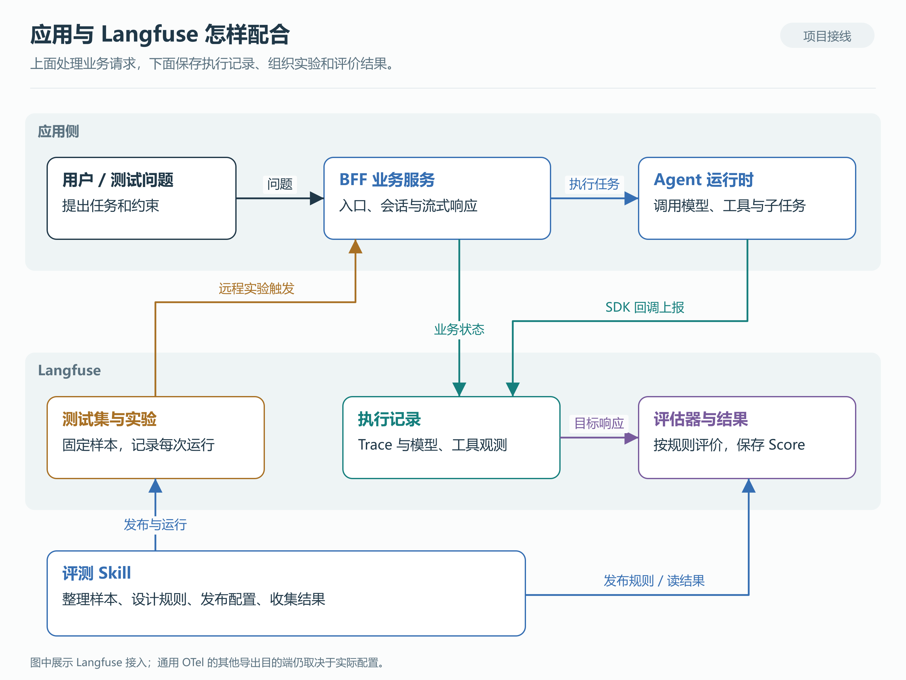

*图 1：依据项目接线绘制的匿名架构图。业务请求、观测上报、实验触发是不同的数据流。[SVG](diagrams/01-system-architecture.svg) · [Mermaid](diagrams/01-system-architecture.mmd)*

| 能力归属 | 本文涉及的内容 |
|---|---|
| Langfuse 原生能力 | 观测接收、Dataset/实验、Evaluator/Rule/Score，以及远程实验触发机制 |
| 项目应用侧接入 | BFF webhook 与 runner、身份和 Session 适配、SSE 处理、Agent 回调、业务状态投影 |
| 项目专项 Skill | 解释来源、组织真实响应证据、设计与编译评估器、发布读回、运行对账及结果解释 |
| 随文材料 | 架构图、合成任务、提示词设计和接口契约；不包含公司服务或专项 Skill 的完整实现 |

远程实验 webhook 是平台支持的触发机制；收到通知以后如何调用我们的应用，是 BFF 的工作。安装 Langfuse 本身不会自动获得本文的业务适配和 Skill 工作流。

## 三、观测接入：从 BFF 到模型与工具

### 先确定一次执行的边界

Trace 把共享同一 `trace_id` 的相关操作组织起来；Observation 表示其中的一步，例如模型生成、工具执行或检索。一次任务可以跨服务，也可以包含异步步骤，Trace 不要求严格对应一个 HTTP 请求。[观测数据模型](https://langfuse.com/docs/observability/data-model)

在我们的结构中，用户请求先进入 BFF，再进入 Agent graph。模型决定下一步动作，工具返回结果，Agent 据此继续调用模型或生成最终回答。观测接入需要覆盖这一循环，而不只是保存最后一次模型输出。

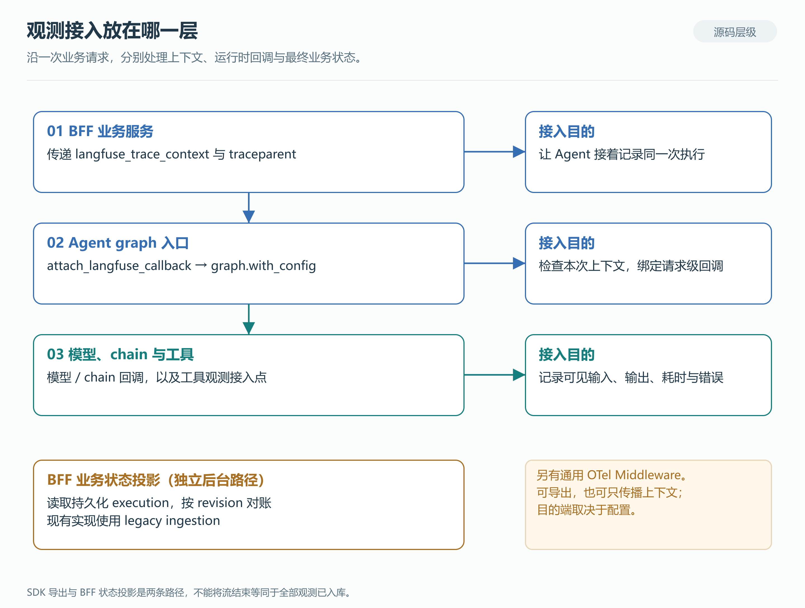

*图 2：接入位置来自本地生产入口和调用代码；图中不代表所有部署分支均已验证上报成功。[SVG](diagrams/02-instrumentation-layers.svg) · [Mermaid](diagrams/02-instrumentation-layers.mmd)*

### 三个接入位置各自解决什么问题

**BFF 业务服务层负责传递请求上下文。** 调用图服务时，它将 `langfuse_trace_context` 和 W3C `traceparent` 放入配置，让下一层能够继续记录同一次执行。业务 execution ID、会话 ID 和观测 Trace ID 各有用途，不能只因为都叫“运行 ID”就混用。

**Agent graph 入口负责绑定本次请求的回调。** 生产入口调用 `attach_langfuse_callback`，检查 execution context，为本次请求创建 LangChain CallbackHandler，再通过 `graph.with_config` 绑定。模型和 chain 使用相应回调记录，工具另有观测接入点。graph 可以复用，请求关联的回调则需要跟随本次上下文，避免并发请求混到同一条链上。

**BFF 观测服务层补充业务执行状态。** 现有代码根据持久化 execution 记录投影根观测，并按 revision 对账。这条历史接入仍使用 legacy ingestion，与 Agent SDK 回调的导出路径不同。它负责补充的业务状态，也不能仅根据客户端连接是否关闭来判断。

源码同时存在通用 OTel Middleware，用于建立 `agent.run` span；是否导出、发往哪个后端，取决于实际开关与 endpoint，也支持只传播上下文。因此，“项目用了 OTel”不能直接推出“所有 OTel 数据都已进入 Langfuse”。SDK 创建和导出观测，Langfuse 服务端接收 OTLP，两端与中间传播都要分别确认。[SDK 概览](https://langfuse.com/docs/observability/sdk/overview)、[OTel 接入](https://langfuse.com/integrations/native/opentelemetry)

### 有调用链，还要看证据能否回答问题

会议室任务中，知道调用过查询工具，只能证明发生过一次调用。要检查时间条件，还需要实际参数值；要检查推荐依据，还需要返回正文。现有 SSE 客户端保存了部分工具摘要，包括名称、状态、参数键名和数量，**这些摘要不包含完整参数值和工具返回正文**。相关评价必须另取足够的观测或业务记录。

同样，多个模型节点不一定表示多个 Agent；没有看到预约 span，也不等于预约一定没有发生。应结合父子关系、采集覆盖和实际状态判断。工程上需要的是可见消息、调用参数、返回和产物，不需要采集模型隐藏思考。

接入验收可以围绕一条真实请求问四件事：入口和运行时是否关联；关键模型与工具步骤是否可见；应用终态是否明确；所需材料是否足以解释结果。页面中出现一条 Trace，只完成了其中一部分。

## 四、评测设计：从业务要求到判断依据

### 测试题、参考和评价规则分开保存

Dataset 保存一组任务，Dataset Item 保存单条输入、参考和上下文。我们使用稳定的 `case_uid` 关联后续资产，将原问题与参考分开：应用得到原问题，评估器使用参考。`input`、`expectedOutput` 和 metadata 内部的业务结构由应用约定，字段存在不代表平台已经知道如何评分。[Dataset 文档](https://langfuse.com/docs/evaluation/experiments/datasets)

以合成任务为例，样本需要保存原问题、房间资料的来源、时区和“仅查询”的约束。评价计划再说明本轮检查推荐、参数、动作还是回答质量。修改裁判模型或提示词，不应该顺手改写原问题和预期；否则两次实验的差异就失去了共同基准。

用某个应用配置跑这批样本，就形成一次 Experiment / Run。Run Item 把其中一条样本连到这次实际执行的 Trace 和目标观测；后续 Score 再指向被评目标。这样，同一道题重跑多次，仍能区分每次的回答与评价。

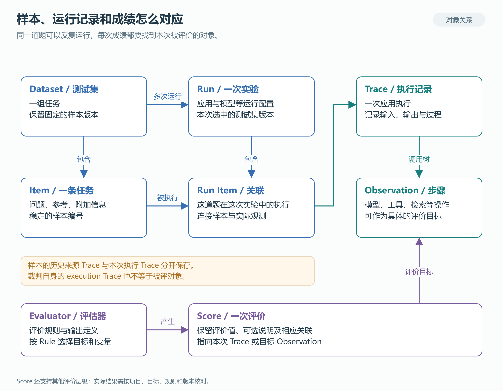

*图 3：概念关系示意。同一道题可以参加多次实验，当前分数必须指向当前执行；具体 API 字段随版本而异。[SVG](diagrams/04-evaluation-object-model.svg) · [Mermaid](diagrams/04-evaluation-object-model.mmd)*

这里有三种 Trace 尤其容易混淆：历史 Trace 可以是样本来源；实验执行产生新的被评 Trace；裁判调用还可能产生自己的 execution Trace。收集结果时要识别目标，不能按题目文本、时间接近或同名分数认领成绩。

### 指标从任务的成功条件里选

Agent 的评价对象不仅是回答，还包括动作、产物和环境状态。Anthropic 的评测方法区分运行记录与最终结果，LangChain 的实践则讨论了单步、完整轮次和多轮任务。这些划分有助于决定测试范围，并不要求所有应用采用同一套指标。[Agent 评测方法](https://www.anthropic.com/research/demystifying-evals-for-ai-agents)、[Deep Agent 评测实践](https://www.langchain.com/blog/evaluating-deep-agents-our-learnings)

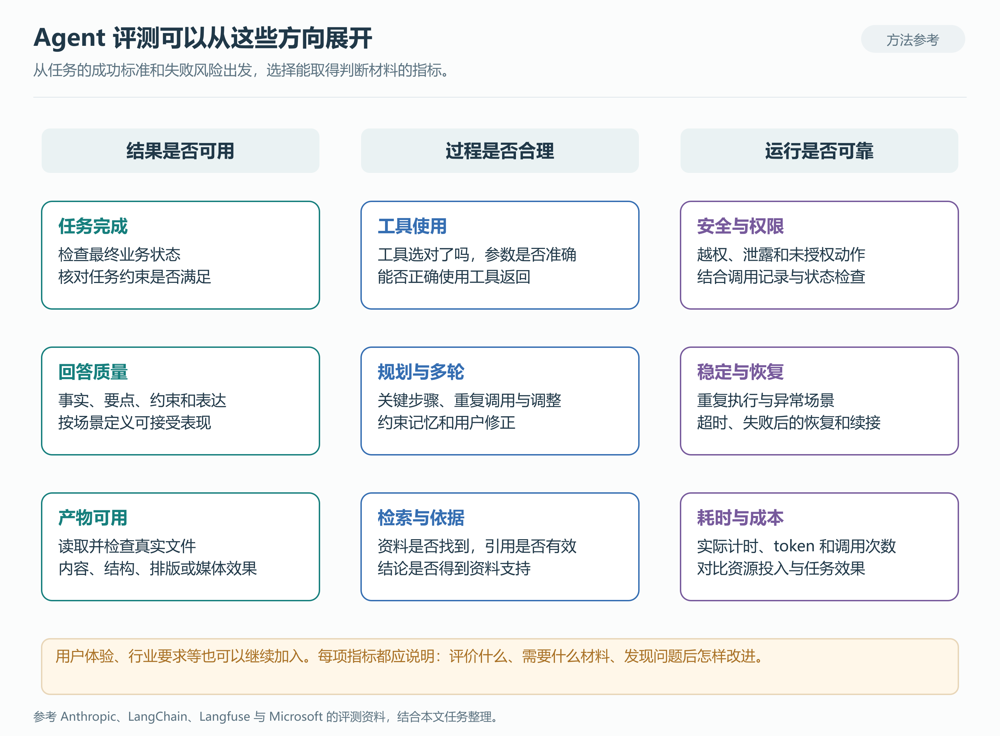

*图 4：通用评价方向，不表示本项目已经实现图中全部能力。[SVG](diagrams/05-agent-evaluation-map.svg) · [Mermaid](diagrams/05-agent-evaluation-map.mmd)*

| 评价方向 | 典型问题 | 主要判断材料 |
|---|---|---|
| 任务完成与业务结果 | 任务是否完成，最终状态是否满足要求 | 业务状态、实际产物、可信预期 |
| 回答质量 | 事实是否正确，要点是否齐全，是否遵守指令并回应问题 | 原问题、响应、约束、参考 |
| 工具使用 | 选对工具了吗，参数是否正确，是否使用了返回结果 | 工具 schema、参数、返回与后续动作 |
| 执行过程 | 是否漏掉必要步骤，能否根据反馈调整 | 可见轨迹、阶段状态、允许的执行路径 |
| 检索与依据 | 检索和引用是否支撑结论，资料是否过期 | 检索结果、文档版本、引用 |
| 多轮与记忆 | 是否接受用户修正，是否串用其他会话信息 | 相关轮次、状态与记忆读写 |
| 安全与权限 | 是否越权、泄露信息或执行未授权动作 | 权限规则、调用记录、状态及受控测试 |
| 稳定性与恢复 | 多次运行是否一致，工具失败后怎样处理 | 重复试验、异常场景和恢复记录 |
| 效率与资源 | 首次响应、总耗时、token 和费用如何变化 | 实际计时、usage、计费依据 |
| 文件、多模态与交互 | 产物能否使用，是否需要澄清或交接 | 文件及渲染结果、完整对话、用户反馈 |

不必把每一项都加到每个用例里。会议室单轮查询首先要检查推荐、查询参数和操作边界；没有长期记忆参与，就不必为它安排记忆评分。指标选好后，还应能说明发现问题以后要改哪一部分。[选择评价目标](https://langfuse.com/academy/evaluate/choosing-what-to-evaluate)

### 项目初期优先采用的四项质量指标

在公司项目初步构建评测集时，我们优先采用**正确性、完整性、指令遵循和相关性**，先建立回答质量的基础评价。这四项覆盖了事实是否可靠、内容是否齐全、是否遵守要求、是否回应问题，便于从第一批样本中发现和定位问题。

**这是一组起步指标，评测体系仍有待扩充。** 随着任务和工具能力增加，后续还需要围绕工具选择与参数、业务动作和状态、任务完成、多轮上下文、安全、时延及成本等方向扩展。具体增加什么，应由业务场景和可取得的证据决定。

现有 Skill 为这四项分别设计提示词和原生 Evaluator，覆盖本轮选中的用例，同一次应用响应分别接受各项评价。后文讨论如何减少重复裁判输入，但不把尚未实现的合并写成当前能力。这样的实现记录了当前阶段的选择，不代表 Agent 评测只有四个维度，也不代表 Langfuse 的能力边界。

| 指标 | 衡量什么 | 在会议室任务中如何落到规则 |
|---|---|---|
| 正确性 `correctness` | 事实、结论和计算是否与可信依据一致 | 推荐及容量、设备、时段说明应与查询返回一致；不能让裁判凭常识猜房间状态 |
| 完整性 `completeness` | 是否覆盖本任务要求的要点 | 用户要求房间名称和理由；不要额外要求未提供的楼层、预约编号 |
| 指令遵循 `instruction_adherence` | 是否遵守实际适用的指令和约束 | 人数、设备、日期与只查询要求分别核对；动作约束需要动作证据 |
| 相关性 `relevance` | 是否围绕当前问题和必要上下文 | 内容是否帮助完成查询；不能只因回答详细就判定偏题 |

规则还要写清可接受的等价表达、重要偏差和证据缺口。评分类型与分档由本次设计和原生输出合同确定，本文不替项目新增阈值、固定权重或总分。正确性低，不必把相关性也判低；违反关键动作约束，也不能被其他维度的高分掩盖。

### 程序、模型和人工如何配合

日期参数、JSON 结构等确定性条件适合程序检查；解释是否完整等语义问题适合模型裁判；争议规则与裁判校准需要人工参与。过程检查应允许合理的替代路径，不必要求 Agent 复制唯一一条调用轨迹。

Langfuse 提供 Code Evaluator，但当前文档规定其沙箱没有网络出口，并有限定的语言、依赖和执行时间；自托管还需配置 dispatcher。需要业务状态时，应先由有权限的执行器取得，再交给评价逻辑。[Code Evaluator](https://langfuse.com/docs/evaluation/evaluation-methods/code-evaluators)

目前专项 Skill 的设计合同只接受 `llm_as_judge`，正式收集只接受可归属的 `EVAL` 成绩。外部程序经 Score API/SDK 写入的是 `API` 来源，不会自动进入这条报告流程。因此，会议室动作边界的程序检查在本文中仍是扩展设计，不能因为画进架构图就宣称已经接入。

## 五、评估器接入：提示词、模型与变量映射

### 评估器不是一段孤立的提示词

Evaluator 定义评价方法、提示词、模型和输出；Rule 决定哪些记录进入评价，以及采用什么映射和排程。模型是执行裁判任务的服务，Score 是评价留下的结果。这里的“定制”是定制评估器、规则和裁判提示词，再绑定模型，没有训练新底层模型。

当前 Skill 编译器会核对提示词占位变量与声明，再生成原生模型配置、输出定义和映射。发布时还要读回 Evaluator、Rule 和版本。结构一致是程序可以检查的；“这些资料是否足以判断推荐正确”仍需要 AI 或人理解业务。

### 官方的取数边界：看目标字段，也看规则映射

构建阶段，AI 可以阅读响应、观测或文件来设计评估器。正式评分时，Langfuse 根据变量映射提取材料，填入裁判提示词，再调用模型。这两种阅读范围需要分开理解。

官方当前 observation 级评估器从匹配的 observation 取 input、output、metadata 或工具调用信息，不自动加载同一 Trace 的子节点、兄弟节点。实验评价还可以使用该次实验的预期输出和样本上下文。多个节点上的材料需要由接入代码组织到目标可读字段中；仅在页面上看得到工具节点，并不意味着裁判已读到。[官方取数说明](https://langfuse.com/docs/evaluation/evaluation-methods/llm-as-a-judge#data-available-to-observation-level-evaluators)、[实验映射说明](https://langfuse.com/faq/all/llm-as-a-judge-migration)

这个限制针对新的 observation/experiment 路径。旧 trace/dataset 评估器可以按映射选择同一 Trace 内的具名观测，不应把两种机制混写。当前项目被核查的实验规则使用 Dataset 与实验根观测过滤。

### 我们的评估模型实际拿到了什么

为确认接入效果，我们只读核对了公司环境中的 Evaluator、Rule assignment，以及已有测试实验里四项评估器各一次的裁判输入记录。核对时同时匹配了任务、评估器版本、规则和被评目标，并将模板与已渲染消息对应起来。下表只展示字段类别，不包含业务原文；它说明抽查记录的实际输入，不代表所有实验都具有同样完整的材料。

| 裁判变量 | 抽查记录中包含什么 | 使用时要注意什么 |
|---|---|---|
| `input` | 原问题 `message`，以及应用、入口等正常上下文 | 评价的是原任务；隐藏参考不应进入被测应用输入 |
| `expected_output` | 参考 `reference` 及其来源信息 | 参考的可信程度取决于样本来源，不由裁判自行补造 |
| `output` | `answer`、完成态、错误与耗时，以及工具/子任务摘要、部分参数事实和结果事实 | 是结构化执行输出，不只是回答文本；摘要保留多少事实要逐字段看 |
| `tool_calls` | 标准工具调用结构，如调用 ID、名称、arguments、类型和索引 | 与 `output.tool_calls` 不是同一份结构；本次抽查中的标准 arguments 为空对象，不能据此检查完整参数 |
| `experiment_item_metadata` | 用例标识、场景与样本上下文 | 三次抽查记录中为结构化上下文，另一次为空；不能假定每次都已填入 |

这里最容易混淆的是两处工具信息。标准 `tool_calls` 表达工具调用，本地取数实现没有为它附加工具执行返回正文。项目 runner 则会把可取得的执行事实整理进 `output`；抽查的 `output.tool_calls`、`tool_requests` 中包含参数键、部分参数事实、结果类型、长度、状态和产物摘要等。它们确实给裁判提供了额外材料，但仍不等于完整的参数原文、工具返回正文或独立业务状态读回。

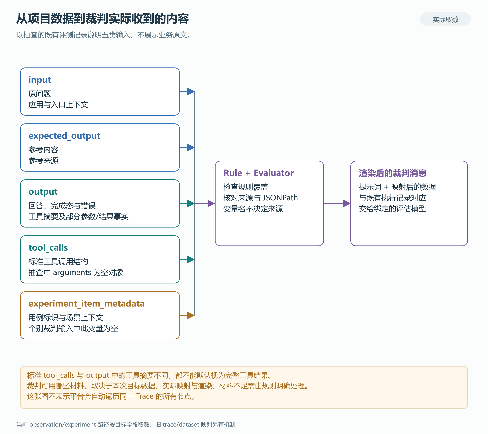

*图 5：依据现有配置和既有裁判输入记录绘制，只展示数据类别。左侧字段是否有值、具体保留哪些内容，仍要按当次执行检查。[SVG](diagrams/05-evaluator-inputs.svg) · [Mermaid](diagrams/05-evaluator-inputs.mmd)*

### 生效的是哪份映射，必须查到 Rule

Evaluator 可以有默认映射，Rule assignment 还可以覆盖它。我们在配置读回中就遇到了这种情况：变量名为 `experiment_item_metadata`，一条规则却把来源设为 `expected_output`。这说明变量名只是提示词里的占位符，数据实际从哪里来，要看生效映射及 JSONPath。

当前配置与历史执行也要分别核对。前面的映射覆盖和已有记录中的空变量是两个已观察事实；没有更多变更与执行快照，不能直接认定二者存在因果关系。既有裁判观测保存的是渲染后的消息，可以继续验证实际材料；涉及媒体时，观测记录可能保留引用，不等于完整的模型网络请求字节。

接入时可以按“目标上记录了什么 → Rule/Evaluator 生效映射是什么 → 渲染后的消息包含什么”逐层检查。对需要动作或状态证据的指标，如果材料没有进入这些输入，就应补齐接入或明确无法判断，不能只在提示词里要求裁判查看整条调用链。

### 低质量与无法评分是两件事

有可信查询结果，而回答把房间容量说错，可以判断质量偏差；没有查询结果，就无法核对这项事实。此时应保留该指标并说明缺口，不能记零分，也不能删除它。`UNSCORABLE` 或约定的“证据不足”类别，要在输出设计时就能被原生合同表达，不能临时塞进数值字段。

字段为空不会自动让 Langfuse 产出 `UNSCORABLE`。无法评分的表达需要在裁判规则和原生输出合同中约定，并由结果收集检查；仅配置了变量名还不够。

裁判请求报错又是另一种情况：它没有提供有效判断。新评估器还应与人工判断做小样本校准，检查是否误解标准、忽略证据，或被待评内容中的评分指令影响。本文没有这样的项目校准运行记录，不能以提示词完整代替效果验证。

## 六、实验执行：webhook、应用调用与评分

### 谁发请求，问题又由谁逐条发送

Langfuse 支持从 Dataset 页面触发远程实验。我们的 Skill 也通过 Web session 适配器调用 `datasets.triggerRemoteExperiment`。两者走到平台的远程触发机制后，由 Langfuse 向 BFF webhook 发出请求；这个 API 调用不等于浏览器里实际发生了一次点击。[远程实验说明](https://langfuse.com/docs/evaluation/experiments/experiments-via-sdk#optional-trigger-sdk-experiment-from-ui)

本地触发代码发送 `projectId`、`datasetId`、`datasetName` 和 `payload`。**这是一条实验通知，不是逐题 query。** BFF 接收通知后读取 Dataset，runner 才逐条将原问题交给应用。

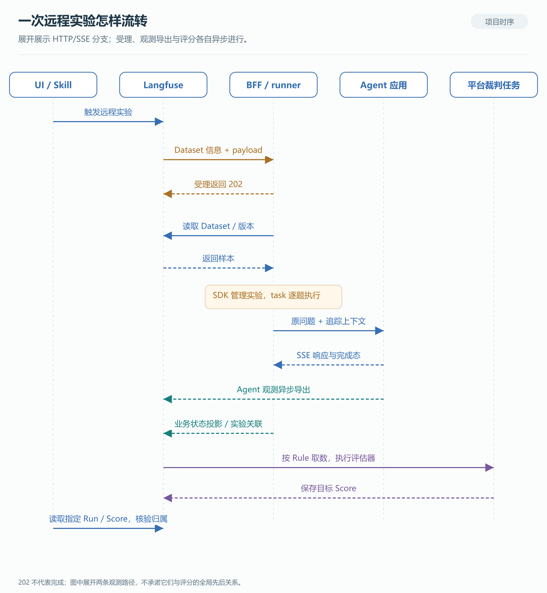

*图 6：依据本地代码绘制，展开 HTTP/SSE 分支。身份覆盖、回放或 Session 上下文可能改走内部会话路径；异步箭头不表示全局入库顺序。[SVG](diagrams/03-remote-experiment-sequence.svg) · [Mermaid](diagrams/03-remote-experiment-sequence.mmd)*

### BFF 接收通知后的处理

BFF 主入口已注册实验 webhook。接收端检查开关、请求大小和认证，解析运行配置，再创建后台任务并返回 202。202 表示已受理，既不证明所有题目执行成功，也不表示评估器已经完成。后台任务开始与受理响应到达触发方，没有严格的网络先后保证。

runner 按名称和可选版本读取 Dataset，并核对 Project/Dataset 身份。当前 Skill 正式发布的配置会固定 Dataset 版本，通用 runner 则保留未指定版本的分支。随后它调用 `dataset.run_experiment(...)`，让 SDK 管理实验关联，将逐题应用调用交给 task。

task 只把原问题和正常业务上下文传给应用，隐藏参考保留给评价。调用路径受身份和 Session 上下文影响：没有解析出的回放或覆盖身份，且没有实验 Session 上下文时，走 HTTP/SSE；否则可能返回主应用事件循环调用内部会话逻辑。不能仅凭“单轮”或 `fixed_account` 标签判断路径。

HTTP/SSE 分支传递追踪上下文，累计响应文本、完成态、错误及部分执行信息。runner 还会另行等待并查询观测，整理 task output。SDK 回调异步导出，BFF 业务根观测也有自己的后台投影，因此流结束时不保证全部观测和分数都可查。HTTP EOF、协议完成态、应用成功和业务成功应分开记录。

### 评分由平台任务完成

现行 `llm_quality` 使用 `platform_only`：BFF 不额外写入 generic regression 分支的 SDK 检查分。Langfuse 根据 Rule 匹配目标、提取映射输入并排程原生评估器，裁判完成后写入目标 Score；Skill 再读取结果并核验归属。

应用执行与裁判执行因而是两个阶段。一次实验调用应用一次，其响应可以分别交给多个评估器；有回答不代表有分数，有分数也要确认是否属于本次配置。平台不会替我们保证整棵 Trace 的所有子节点已经到齐，所需材料必须在目标输入合同中明确。

Langfuse 另有直接运行 Prompt/模型的实验路径，适合比较提示词或模型输出。本文的 BFF runner 会进入业务应用，涉及身份、上下文、工具和编排。选实验入口时，应先确认测试对象。SDK/OTLP 是观测上报，实验 webhook 是执行触发，评估器负责评分，事件通知类 webhook 则传达事件；这几种数据流不要合并理解。

### 超时后为什么先对账

本地 Langfuse 远程 POST 的 20 秒超时只约束触发请求，不是整次实验时限。BFF 每次受理会生成新的 trigger ID，因此触发方超时后立即重发，可能形成两次实验。

Skill 会保存请求意图与派发状态，对未知结果先查已有记录。是否重试取决于具体证据、授权范围和剩余预算；新尝试保留旧记录。这里没有可据以宣称端到端 exactly-once 的证据，也不能把 Skill 的去重检查等同于业务接口具备幂等能力。

## 七、结果核验：失败、缺分与归属异常

### 报告从应跑范围开始

如果只遍历已经返回的结果，很容易漏掉没有成功返回的样本。作为一个可核对的例子，官方 Python SDK v5.1.0 在 task 抛错后记录错误，并将异常项排除在最终返回的 `item_results` 外；这不意味着平台必然没有相应错误观测，也不是对本项目部署 SDK 行为的直接证明。[固定版本源码](https://github.com/langfuse/langfuse-python/blob/v5.1.0/langfuse/_client/client.py#L2725)

我们的正式收集逻辑另有一层对账：`quality_runs` 从发布清单（bundle）的 `case_item_map` 初始化预期样本，再匹配平台 Run Items；未匹配的样本仍保留缺失状态。随后按评估计划（EvaluationPlan）中每个指标的排程集合建立状态。`quality_results` 遍历应有集合，缺行按 `MISSING` 处理，而不是只统计已有成绩。

这也意味着基础四项与全部选中用例构成了需要检查的范围；专项项按实际计划处理。某项已经得到合法的“证据不足”类别，可以说明原生结果收到了，却不能说明这一项已经能够评价。

### 分数存在，还要核对归属

正式质量流程只接收 `source=EVAL`。收集时核对目标 Trace/root、Evaluator、Rule 和版本，必要时补读裁判 execution metadata；Run、Item 等字段如果存在冲突也会排除。历史同名分数、外部 API 分数和本轮不相关结果，不能因为数值看起来合理就进入报告。

重复结果也不应简单取最新一条。现有代码会区分已证明属于同一次原生多选分类执行的多个 Score，与重复或无法证明的评价调用，并保留原始 ID 和值。评价说明在通用 Score 中是可选字段，本项目的裁判设计则要求简短理由。[Score 数据模型](https://langfuse.com/docs/evaluation/scores/data-model)

### 四类问题分别呈现

| 报告视角 | 要回答的问题 | 典型情况 |
|---|---|---|
| 收集完整性 | 应有的样本和评价结果是否收到 | 缺 Run Item、缺 Score、归属异常 |
| 执行健康 | 应用和裁判是否正常执行 | 应用失败、裁判错误、仍在运行 |
| 可评估性 | 材料是否足以作出判断 | `UNSCORABLE`、关键工具或状态证据缺失 |
| 业务质量 | 已有有效判断说明了什么 | 推荐错误、遗漏要点、违反约束；也可能符合要求 |

低质量可以是一次合法实验发现的问题，不能当作采集失败重跑到“通过”。反过来，数据收齐和脚本退出成功也不等于业务质量合格。现有报告保留原生分布，通过 `result_interpretation` 解释结果含义；没有约定阈值时，不擅自把某个分档转换为通过率。

阅读一条结果时，可以沿着“原问题 → 本次执行 → 裁判实际输入 → 原生值与理由”回查。发现推荐错误，就查工具参数、返回与回答；发现缺材料，就补证据链；发现评分误解规则，就修订评估器并重新验证。三者对应不同的改进工作。

如果以后把结果用于发布门禁，还需另行确定关键项、基线和判定政策。官方 CI/CD 指南要求处理缺样本、重复 ID、task 失败和无效评分，但这不意味着本项目已启用自动发布门禁。[实验与 CI/CD](https://langfuse.com/docs/evaluation/experiments/experiments-ci-cd)

## 八、评测实战中的踩坑与经验

这套体系接入后，我们在实际使用中发现，评测本身也会出问题：同一批材料被多个裁判反复读取，面向测试集的规则匹配到了普通请求，参考答案也可能在映射时接错。下面结合这些经历，聊聊怎样控制评测开销、保留发版检查，以及避免配置和证据上的疏漏影响评价结果。

### 评估器拆得太细，重复输入推高 token 开销

一开始，我们将正确性、完整性、指令遵循和相关性分别交给独立评估器。这样便于逐项设计规则、查看结果和校准裁判。但往后扩展指标时，还要多算一笔账：每增加一个裁判，它需要重新读取多少材料？

第五节已经列出裁判实际收到的内容：原问题、参考、结构化应用输出、工具调用和样本上下文。四个裁判的评分规则不同，许多待评材料却相同。每项都独立调用，这些内容就会被重复输入。执行过程较长、工具摘要较多，再叠加高频触发或重试，评测侧的 token 消耗就可能超过被测应用本身。实际是否超过、超过多少，需要把两侧用量放在同一口径下对账。

把共同材料的输入 token 数记作 D，单条样本需要 M 个独立裁判，重复输入部分约为 M × D。如果将使用相同证据、适合一起判断的指标组织进 G 次联合裁判，这部分可以变成 G × D。指标保持不变，节省来自共同材料的重复输入次数减少。这个估算没有计入规则、输出、缓存计价和重试差异，不能直接当作固定节省比例。

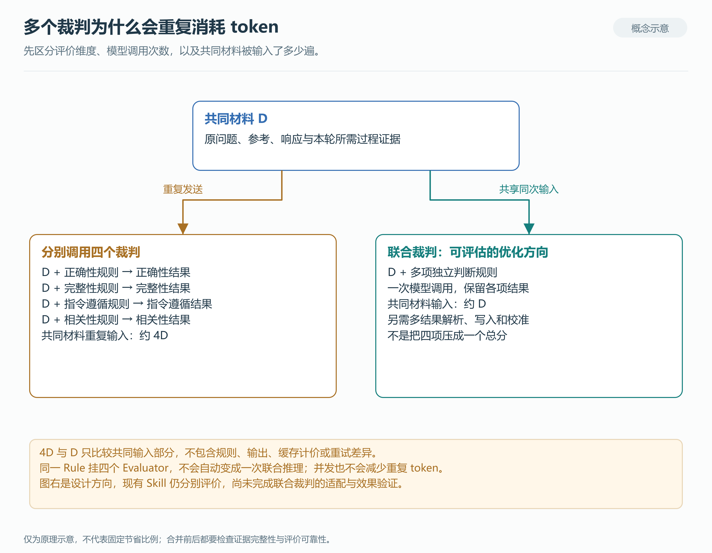

*图 7：共同材料重复输入的示意。联合裁判是后续优化方向，当前 Skill 尚未完成合并，也没有对应的实测节省比例。[SVG](diagrams/08-judge-token-reuse.svg) · [Mermaid](diagrams/08-judge-token-reuse.mmd)*

因此，我们总结出的经验是：**指标可以细分，模型调用不必跟着一项拆一次。** 使用相同证据的指标，可以评估是否适合由少量联合裁判处理；各项结果仍应分别保留。合并之后还要检查维度之间是否互相影响、是否漏掉检查点。几个标准最终只得到一个总分，并不能替代原来的逐项评价。

实现时还有一个容易混淆的地方：把多个评估器挂到同一条 Rule，只是统一了调度范围，不会自动变成一次模型推理。当前原生 LLM-as-a-Judge 的常用输出合同围绕一个评分定义展开，分类多选也不等于若干独立指标。联合裁判需要相应的多结果解析、写入和归属支持，不能只把提示词合在一起。

Langfuse 的 Code Evaluator 和 SDK 评价接口可以承载多结果，但 Code Evaluator 的运行时没有网络出口，不能直接在其中联网调用联合模型裁判。若由外部执行器实现，还要处理 Score 来源；现有 Skill 的正式收集只接受可归属的 EVAL。这部分属于后续适配工作，本文保留当前四项独立评价的实现事实。[原生模型裁判](https://langfuse.com/docs/evaluation/evaluation-methods/llm-as-a-judge)、[代码评估器合同](https://langfuse.com/docs/evaluation/evaluation-methods/code-evaluators)、[SDK 评价接口](https://langfuse.com/docs/evaluation/experiments/experiments-via-sdk)

更容易先落地的做法，是给每个裁判只传所需证据，收窄运行范围，清理重复的同用途规则，把确定性条件交给程序检查，再按业务需要降低细粒度质量评价的频次。并发可以缩短等待，却不会消除重复输入。看成本时也要一起看模型、输入输出用量、缓存和重试，不能只看评估器有几个。

### 发版后只测部分场景，容易漏掉可用性问题

成本需要控制，发版后的基本可用性仍要有人检查。由此总结出的做法，是保留一组小而稳定的场景冒烟集：生产发版后，用少量代表性用例检查已经确认的场景入口和关键依赖，先发现“这项能力还能不能用”的问题。

选用例时，先列场景，再说明每个场景由哪条用例覆盖、依赖什么工具或服务、什么结果算完成。一个用例可以覆盖多个相关检查，但不能因为某个场景最近少用，就把它从发版检查里省掉。这里追求的是场景层面的覆盖，不是一条代表用例穷尽所有业务分支。

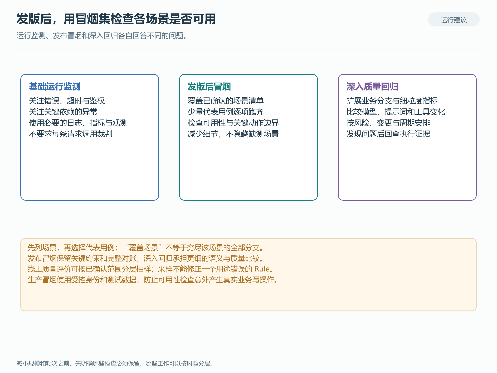

*图 8：从实际工作中总结的检查分工；图中不表示本项目已部署自动发布流程。[SVG](diagrams/09-evaluation-cadence.svg) · [Mermaid](diagrams/09-evaluation-cadence.mmd)*

冒烟优先看入口能否响应、关键工具是否可用、任务是否进入明确终态、必要产物能否读取，以及关键动作约束有没有被破坏。例如用户要求“查询但不预约”，这条边界就应保留。回答风格和更细的完整度评价，可以放到深入回归中；明确的错误、状态和协议检查，也不必都让模型再判断一遍。

| 检查层次 | 主要用途 | 如何控制开销 |
|---|---|---|
| 基础运行监测 | 持续发现错误、超时、鉴权或关键依赖异常 | 使用必要的日志、指标和观测，不要求每条请求都调用裁判 |
| 发版后冒烟 | 检查已确认场景的基本可用性和关键约束 | 小规模代表用例，按本轮清单逐项完成；减少细节评价，保留场景覆盖 |
| 深入质量回归 | 比较模型、提示词、工具或编排变化的影响 | 按风险、变更范围和约定周期运行更多样本与细分指标 |

生产冒烟要使用受控账号、可清理的测试数据或合适的只读路径，避免检查过程意外产生真实预约、发消息等业务操作。执行失败、缺材料和缺分也要如实留下，不能为了节省预算就默认通过。冒烟补充的是发布后的可用性检查，发版前回归和持续运行监测仍要保留；是否用于门禁，则需要另外明确判定政策。[评测与持续改进](https://langfuse.com/academy/evaluate)、[实验与 CI/CD](https://langfuse.com/docs/evaluation/experiments/experiments-ci-cd)

### 没有限定 Dataset，测试裁判也会评普通请求

这是我们实际遇到的一类配置问题。排查时发现，三条规则都没有指定 Dataset：一条只筛选没有物理父节点的观测，另外两条筛选 GENERATION 并排除部分内部环境，采样率均为 100%。这些条件没有把评价限定在测试集里，普通请求的根观测或模型生成也可能匹配，一条业务 Trace 中还可能出现多次模型生成。

问题在于，**为测试集定制了评估器，并不等于限制了它的执行范围。** Evaluator 定义“怎么评”，Rule 决定“评哪些记录”。评估器名称里写了测试集名称，也不会自动产生 Dataset 过滤条件。[Evaluator 与 Rule 的分工](https://langfuse.com/docs/evaluation/core-concepts#evaluators-and-rules)

发现范围过宽后，这三条规则已被停用，历史结果继续保留。下面是停用后的真实页面记录。

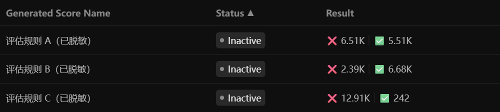

*图 9：真实页面的脱敏截取。仅保留三条规则与相关列，名称已替换，状态和结果数量未改变。*

页面显示的两类结果分别为：A 的 6.51K 与 5.51K，B 的 2.39K 与 6.68K，C 的 12.91K 与 242。K 是界面缩写，这些数字统计的是评分结果，不能直接当成独立模型调用数、业务 Trace 数或 token 总量。完整的启停和配置变更历史尚未对齐，因此也不把全部累计结果归因于当前保留的配置。费用列为空或显示 $0.00，同样不能说明没有实际推理成本。

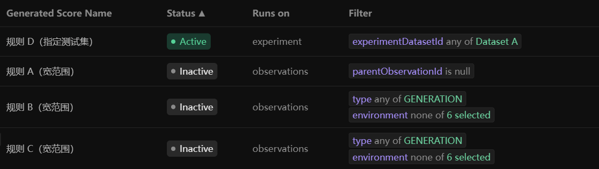

*图 10：同一页面中的现有规则对照，规则和 Dataset 名称已匿名化，隐藏了无关列并调整换行。D 使用 experiment 与指定 Dataset；A/B/C 使用更宽的 observations 过滤。控件状态、筛选含义均保持实际值。*

还有一个细节值得留意：同一个 Evaluator 可以同时被宽范围规则和 Dataset 专用规则引用。收窄范围时，应检查它关联的各条 Rule，不能只改其中一条就认为已经处理完。对于真正需要在线质量监控的场景，Observations 模式本身没有问题；业务范围、采样、预算和判断材料明确以后，它可以承担相应工作。

### 把实际输出映射成参考答案，裁判会拿错依据

检查触发范围时，我们还发现了另一处问题：宽范围 B 规则把 `ground_truth` 映射到了待评 `output`，而同一 Evaluator 的一个 Dataset 专用规则将它映射到 `expected_output`。变量名称看起来仍是“参考答案”，实际取到的却是被测系统自己的输出，这份参考也就失去了独立性。

这提醒我们，人工配置时需要把**范围和变量映射一起检查**。下面用同一项目中已有的 Dataset 专用配置说明具体落点，没有临时创建演示规则，也没有保存任何修改。

对于本文的 SDK 实验链路，界面采用 **Run on → Experiments → Experiment Runner SDK**，再用 **Filter → Dataset → any of** 指定测试集。

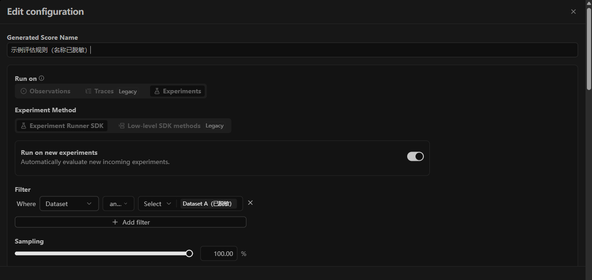

*图 11：真实配置页的脱敏截取，规则显示名和 Dataset 名已匿名化。图中 100% 是该现有规则的采样设置，不是对所有线上评价的统一建议。*

平台配置读回还包含“实验 Item 根观测”的限制。界面、API 和不同版本的字段名可能不同，核对时应看实际含义：**指定 Dataset，并选择本次样本对应的评价目标**。仅用 `parentObservationId is null`，不能代替 Dataset 过滤，也不等价于选中实验 Item 的逻辑根观测。

把这两类问题放在一起，人工配置时可以按下面的顺序检查：

1. 确认目标项目，以及本轮用途是离线实验还是在线监测。
2. 检查 Rule 是否限定目标 Dataset 和合适的观测，而不只有通用类型或环境排除条件。
3. 查看同一 Evaluator 的其他启用规则，排除重复排程或范围遗漏。
4. 逐项核对原问题、可信参考和实际输出的来源，尤其不要让 `ground_truth` 指向待评 `output`。
5. 检查新数据触发、历史数据补评和采样设置，确认实际匹配范围。
6. 保存后读回配置，再用范围明确的小批量验证目标和结果归属。

本次发现的映射差异没有通过重跑做影响分析，因此不能据此断言每条历史成绩都出了问题。但它足以说明：提示词里的变量名、配置中的来源字段和最终渲染的内容，需要对得上。

采样率应在范围正确之后再调整。小规模发布冒烟集要按计划把代表性场景跑齐；大量普通线上请求则可以按场景分层抽样，或降低质量评价频次。范围配错时，降低采样率只能减少误触发数量，不能修正这条规则的用途。

### 看得到完整调用树，不代表裁判读到了全部节点

在 Langfuse 页面上展开 Trace，很容易以为裁判也会沿着这些节点逐个检查。实际上，Trace 树可能包含 BFF、Agent、Middleware、模型和工具等多个层次，当前 observation/experiment 裁判不会自动把所有节点的内容拼成输入。页面记录完整，不等于已经完成整条 Agent loop 的过程评价。

第五节的实际输入核查也说明了这一点：我们的结构化 `output` 中已经有部分工具摘要、参数和结果事实，裁判可以据此评价相应行为；没有进入输入的调用顺序、完整参数、工具正文或业务状态，则不能由模型自行补全。这里需要看的是实际传入了哪些证据，而不只是 Trace 页面上有没有相应节点。

如果要深入评价 Agent loop，先明确要检查哪些关键步骤，再将相关观测按执行关联整理成可追溯的过程证据，或为明确的模型、工具节点配置评价。证据还应说明采集范围和缺失部分。这样既能避免裁判在缺材料时凭空判断，也能减少把整棵树重复发给每个裁判的开销。[官方取数边界](https://langfuse.com/docs/evaluation/evaluation-methods/llm-as-a-judge#data-available-to-observation-level-evaluators)

## 九、Skill 自动化：AI 如何构建评测集

前面分别讲了观测、评估器和实验。专项 Skill 的工作，是把这些能力组织起来，让测试人员不用在来源表格、应用接口和平台配置之间反复搬运信息。

这里有两种 AI 角色：当前 AI 会话负责理解来源、判断证据和设计规则；正式运行时，绑定的裁判模型负责按已发布规则评分。前者不能用自己的分析替代后者的原生 Score。脚本则执行平台操作、保存状态并检查结构和归属。

### 从资料到 CaseSet：先保留来源，再理解语义

读文件的工具先保留原文、表格行列和位置。AI 判断哪些列是问题、哪些是预期，以及本次选择哪些内容，再由程序按原单元格提取。整理后的本地用例集合称为 CaseSet；已有规范 CaseSet 时直接验证，需要从文档构造样本时，则进入来源构建流程，保留依据。

已有测试问题要保留原题、原预期和 UID；从需求补出的边界问题应标为候选，说明依据。例如“没有符合房间”“日期缺失”“用户改变人数”可以是扩展方向，但只有需求支持的行为才进入可信预期。AI 生成的答案不能因为格式完整，就成为判断对错的依据。

CaseSet 组织的是任务本身。EvaluationPlan 组织的是本轮指标、提示词、模型、映射和适用范围。源 Dataset 的身份依据排除计划专属指标注解，使模型或规则修订不必顺带改动源问题。这里的独立性是版本管理设计，不表示任何环境变化都可以无条件复用旧证据。

### 两种目标，两条分支

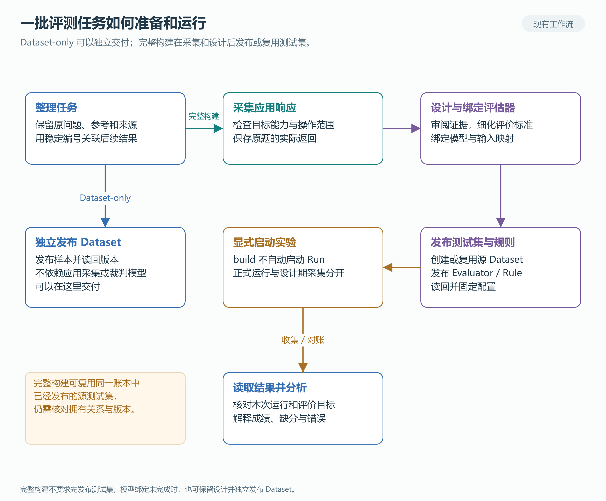

*图 12：依据现行 StageRunner 绘制。独立 Dataset 可以直接交付；完整 build 在采集和设计之后发布或复用 Dataset，且不会自动启动正式 Run。[SVG](diagrams/02-evaluation-workflow.svg) · [Mermaid](diagrams/02-evaluation-workflow.mmd)*

**只整理并发布测试集时，走 Dataset-only。** `dataset_release` 将 CaseSet 转为 Dataset/Items，发布后读回内容与版本。这条路径不依赖应用响应、模型绑定或评估器设计，适合先形成可审阅的测试资产。

**需要完整评估资产时，先采集、再设计。** StageRunner 检查平台能力和操作影响，在已有授权范围内采集原题的实际响应，封存后交 AI 审阅，再进入设计、绑定和发布。完整构建并不要求先把 Dataset 发布到平台。模型暂未绑定时，也可以保留设计，并按已有范围独立交付 Dataset。

### 各阶段交出什么

| 阶段 | 输入与输出 | 检查和失败处理 |
|---|---|---|
| 来源准备 | 文档、表格或 CaseSet → 保留出处的选中用例 | 列与范围不明确时交 AI 解释；不静默改原题和预期 |
| 采集准备 | 用例、目标身份、平台能力、任务范围 → 采集计划与请求意图 | 判断实际影响，核对授权和预算；有在线规则不等于一定禁止采集 |
| 响应采集 | 原题 → HTTP/SSE 事实、实际返回及关联标识 | 逐题保存；成功项不重发，未知状态先对账 |
| 证据审阅 | 全 UID 快照与实际读取材料 → 逐题充分性判断 | 区分业务回答、拒绝、业务失败、空响应和传输错误 |
| 评价设计 | 原预期、实际响应、基础规范与平台能力 → 指标、完整提示词、逻辑映射 | 缺证据可补读；来源歧义或能力不足明确保留，不能反造参考 |
| 模型绑定 | 模型无关设计、项目连接目录 → 具体 provider/model 与计划 | 匹配不明确时等待，不静默换模型；连接存在不证明推理可用 |
| 发布与读回 | CaseSet 与计划 → Dataset 版本、Evaluator/Rule、发布 bundle | 校验定义、版本与拥有关系；写入结果未知先查，不盲目重发 |
| 正式运行 | 已发布 bundle、明确运行请求 → 原生 Run 引用 | 核对范围和预算；build 完成不自动触发 |
| 收集与交付 | 指定 Run、计划与原生成绩 → 逐项状态、解释和交付报告 | 按预期集合对账；保留原值、缺分、错误及无法评分 |

表里的判断并不意味着每个节点都要再问用户一次。现有授权可以覆盖任务内的必要操作，普通语义判断由 AI 完成；越过范围、预算或用户指定的审阅边界时，才需要新的决定。AI 自己写下“approved”不能产生授权。

### 先看真实响应，是为了设计可执行的评价

相同问题可能返回文本、结构化对象、文件链接，或者一个明确的业务拒绝。设计前看实际响应，能帮助 AI 判断输出形态、证据位置和规则适用性。原预期仍定义任务目标，不能把应用的错误答案改写成标准答案。

现有 `evidence_design` 会提供全部 UID 的结果索引、真实材料的读取回执与 hash、基础质量规范及平台目录。摘要不等于全文，链接不等于已经看过文件；需要时 AI 可补读已知响应、既有 Trace/Observation 或允许的文件资料。

设计可以返回需要更多证据、需要审阅来源、需要平台能力，或设计就绪。在当前阶段，优先采用的四项质量指标分别覆盖选中用例，每项独立编写完整提示词；后续按任务扩展其他指标。缺材料时保留该维度与缺口，不能删掉难评的题来凑齐任务。

采集与正式 Run 还要分开理解。前者为设计收集证据，Skill 不主动调用本轮定制 Judge，但环境已有规则可能产生评分，不能无条件声称“没有任何模型评价”。后者通常再次调用应用，评的是正式实验的新响应，而不是复用设计期答案冒充运行结果。

### 模块如何配合

`dataset_release` 管源样本的独立发布；`evidence_design` 管响应证据与 AI 设计交接；`evaluator_compiler` 将完整设计转成原生定义。`quality_assets` 发布并读回配置，`quality_runs` 派发正式实验并收集原生事实，`quality_results` 校验归属与统计状态。Public API 与 Web session 分别适配资源操作和远程实验等接口。

这些模块共同使用上下文、运行账本和产物存储。结构校验、内容 hash、版本和平台资源 ID 帮助恢复任务；业务语义则留给 AI 判断。例如，一次拒答是否合理，不能靠固定错误码到“通过”的映射解决。

### 中断以后接着做，而不是整批重来

采集默认并发 1，只有明确配置才启用有界并发。网络请求可以并行，账本和完整事件仍由主线程逐题保存。每次派发前记录请求意图，已成功项不自动重发；UNKNOWN 可能已经在服务端完成，必须先看已有执行事实。

AI 可根据证据选择需要重试的已授权 UID，程序核对范围、预算和状态，再建立新意图，保留原尝试。新 request ID 不会自动增加预算。发布返回丢失也一样，先确认平台是否已经创建资源，再决定下一步。

评估修订时，源 Dataset 与模型、提示词分别管理；共享 Rule 不能被当作本轮专用配置覆盖。已有资产、历史结果和原始尝试保留。交付目标若只是 Dataset，就报告 Dataset 的发布与读回；目标包含正式实验，才需要给出那次 Run 的结果。这比一句“自动评测完成”更能说明系统实际做到了哪一步。

## 十、迁移到自己的平台

### 先替换接入合同，再扩展自动化

可复用的是分工、证据链和恢复方式。更换 Agent 平台时，首先需要对齐以下接口，而不是照搬函数名。

| 接入位置 | 需要对齐的内容 |
|---|---|
| 应用入口 | 原问题、身份、会话、任务上下文；隐藏参考不进入应用输入 |
| 追踪传播 | 当前 Trace 与父节点如何传递，SDK/OTel 分别从哪里导出 |
| 响应适配 | 实际输出、协议完成态、应用状态和错误如何提取；不能仅把 EOF 当完成 |
| 证据组织 | 参数、工具返回、文件和状态能否归属到本次执行，是否足以支持评价 |
| 实验绑定 | Dataset 版本、样本 ID、当前 Run 与目标观测如何关联 |
| 评价接入 | 原生目标、变量映射、模型和输出类型是否受当前版本支持 |
| 结果收集 | 从预期集合核对完成情况，保留原生值与异常，不按同名分数猜归属 |

随文的适配接口仅用于说明输入输出职责，不是现有公司服务的公开实现。迁移时先核对自己的协议与 SDK 版本，再决定需要哪些适配代码。

### 数据出口要逐条检查

下面是接入其他平台时应落实的检查方法，不是本项目已经完成全面保密审计的声明。首先按字段确定哪些内容允许进入观测与 Dataset；凭据、认证头、Cookie 和未经批准的客户原文不进入这些资产。随后分别检查 SDK 导出、legacy ingestion、其他 OTel exporter、Dataset 发布、裁判输入及本地报告，确认每条出口实际发送了什么。

Langfuse 的 `mask_otel_spans` 只影响经该客户端处理并导出的 spans，其他 exporter 不会自动继承同样的结果；它也不等于 Dataset 或裁判请求的通用脱敏开关。可以用合成敏感标记验证各出口，并确认处理后仍保留足以评价的事实关系。[Masking 文档](https://langfuse.com/docs/observability/features/masking)

### 接入以后，继续验证什么

把接口和配置连上，只是第一步。接下来应确认真实请求能否关联到正确观测、裁判输入是否包含所需证据、原生 Score 是否对应本次样本，以及失败和缺分是否完整进入报告。配置读回与少量输入抽查各自解决一部分问题，完整验收还需要覆盖实际使用场景。

迁移 SDK 或平台时，应重新核对目标类型、字段映射、写入模式和读取接口。兼容条件以目标部署与[官方迁移说明](https://langfuse.com/faq/all/deprecated-api-migration)为准，不能只替换一个版本号。本文会议室场景仍是用于解释方法的合成材料，未执行或评分。

后续维护可以从失败结果回到具体执行，再把经审阅的条件加入回归；同时固定样本、应用和裁判版本，避免把环境变化误判成模型进步。若这些步骤继续自动化，仍应保留出处、独立判断依据和历史结果，让下一次修改能够解释清楚“变了什么、为什么变”。

完整链接见[参考资料](references.md)，架构与方法图提供[可编辑源文件](diagrams/index.html)；新增页面截图另行标明脱敏范围。
